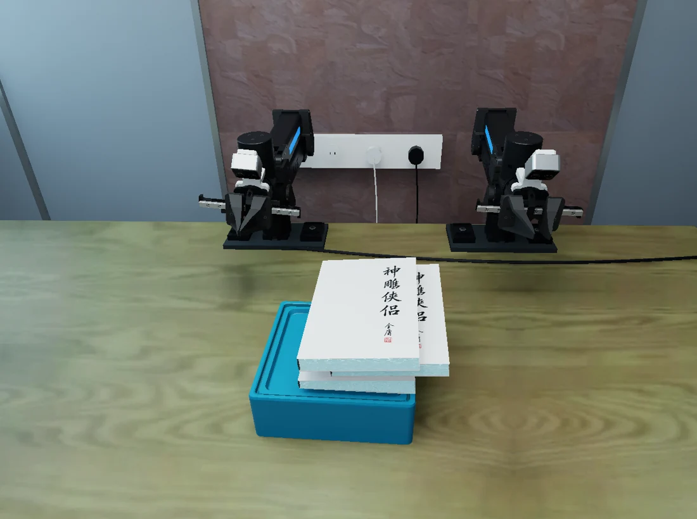

# General-Purpose Foundation Models for Contact-Rich Manipulation
### A Paired Sim–Real Evaluation of GPT-6 Astra

Research software for contact-rich tabletop manipulation on the ARX R5.
The maintained benchmark contains **16 tasks** across L1–L3, each with an
independently selectable original setting and a fixed **variant01** setting.

[Interactive project page](https://tuojingai.github.io/GPT_Benchmark/) · [Installation](docs/release/INSTALL.md) ·
[Evaluation protocol](docs/release/PROTOCOL.md) · [Release guide](docs/release/RELEASE.md) ·
[Asset notices](NOTICE) · [Validation report](docs/release/VALIDATION.md)



## Quick start

Use an editable checkout with Python 3.11. Simulation additionally requires
NVIDIA Isaac Sim 5.1, an NVIDIA GPU and the separate pinned cuRobo environment.

```bash
python -m venv .venv
source .venv/bin/activate
python -m pip install -e '.[test]'
# If using the source-only archive, restore its matching asset bundle first:
# python tools/release/install_assets.py /path/to/r5-benchmark-assets.tar.gz
python tools/verify_runtime_assets.py --usd
python tools/release/check_task_contract.py
python tools/launch.py list
python tools/reproduce.py --tasks L2-02 L2-02_variant01
```

The last command prints an execution plan. It does **not** call a model.
Configure the simulator, planner and model as described in [Installation](docs/release/INSTALL.md),
then add `--execute` to run that plan. Use `--dry-run` for an offline lifecycle
check. It does not run physics or demonstrate task success.

The default workflow runs locally. Machine paths belong in ignored
`configs/runtime/local.toml`; the optional Windows storage template defaults to
D: and accepts another drive or directory. SSH and a cluster are not required.
For remote deployment, readers or coding agents can follow the optional
[remote-deployment skill](skills/r5-remote-deploy/SKILL.md), which contains its
own examples and helpers. This deployment skill is not supplied to the robot's
decision model and does not change the evaluation protocol.

## Task configurations

| Level | Tasks | Fixed alternative settings |
|---|---|---|
| L1 | L1-01, L1-02, L1-03, L1-04, L1-05 | Selected initial placement variants |
| L2 | L2-01, L2-02, L2-03, L2-04, L2-05, L2-06 | P01 initial arrangements |
| L3 | L3-01, L3-02, L3-03, L3-04, L3-05 | Preserved alternative scene/protocol configurations |

For example, `L2-03` and `L2-03_variant01` are separate experiments.
See the [task numbering map](docs/release/TASK_NUMBERING.md) when comparing historical records.
The suffix alias `L2-03_v3` selects the current `L2-03_variant01` setting.
Old task numbers are not aliases: historical runs retain their source numbering
and revision. The former key task is excluded; current L1-05 is flower insertion.

**Alternative settings are not uniformly position-only perturbations.** Some
L3 settings also differ in scoring or budget. See the [protocol table](docs/release/PROTOCOL.md).
Task parameters, asset bytes, controller settings and existing prompts are preserved.

## Reproduction and records

```bash
python tools/reproduce.py --suite original           # show all original settings
python tools/reproduce.py --suite variant01          # show alternative settings
python tools/reproduce.py --tasks L2-03_variant01 --execute
python tools/batch_run.py --summarize runs/PATH_TO_BATCH
```

`reproduce.py` passes each task's existing seed, time and call limits explicitly.
The general-purpose `batch_run.py` has its own CLI defaults; do not assume they
are the paper's settings. Set every override explicitly for a new experiment.

Runs retain configuration snapshots, model requests/replies, observations,
actions, scoring and videos. Summaries separate task failures, interruptions,
timeouts and infrastructure errors. This repository does not invent missing
paper results, real-robot logs or model access rights. Real-robot operating
conditions and skill/history access must be reported separately from simulation.

## Development

```bash
python -m unittest discover -s tests -v
python tools/release/check_task_contract.py
python tools/verify_runtime_assets.py --check-git --usd
python tools/release/package.py --output dist
```

- `src/robot_tasks/`: shared execution, policies, planning, tasks and evaluators.
- `configs/tasks/`: independent original and alternative configurations.
- `assets/runtime.lock.json`: complete runtime input inventory and SHA-256 hashes.
- `tools/release/`: behavior/asset checks, packaging and initial-state rendering.
- `skills/r5-remote-deploy/`: optional SSH deployment guide and helpers.
- `site/`: responsive, buildless project page; GitHub Pages workflow included.
- `runs/`, `reports/`, caches and private host settings remain unversioned.

## License and citation

Team-owned code: [Apache-2.0](LICENSE). Third-party material retains its original
terms; see [NOTICE](NOTICE) and the [permission manifest](docs/release/asset_permissions.json).
Use [CITATION.bib](CITATION.bib) for the software. Author and paper publication
metadata will be added when finalized.
