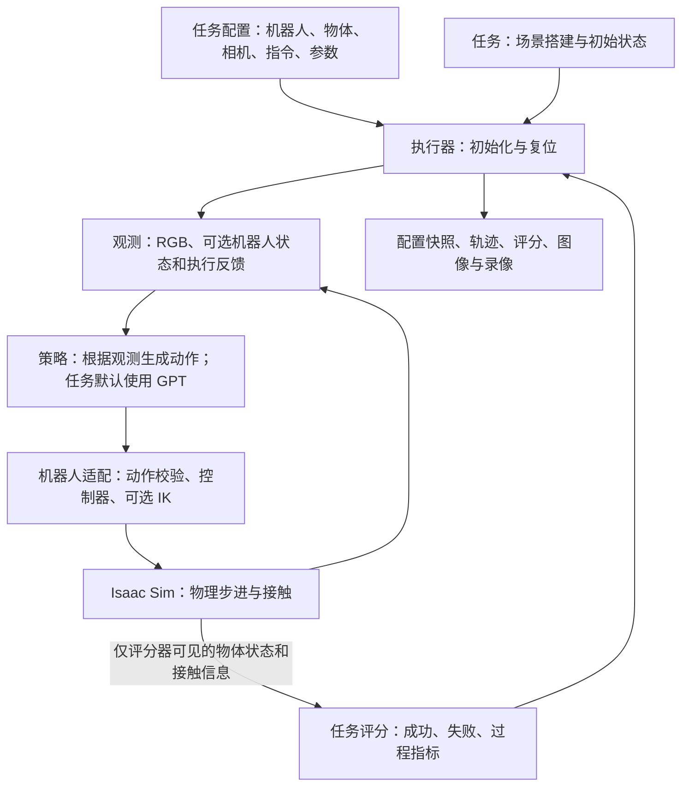

# GPT Benchmark：R5 物理交互测评

本项目使用 **ARX／方舟 R5 双臂平台**。已接入 16 个 L1—L3 仿真任务，以及独立的 GPT 单臂抓放工程检查。任务共用模型接口、三路 RGB-D、相机参数和图像标记、cuRobo 轨迹执行、录像及独立评分。

任务配置位于 `configs/tasks/`，每项包含英文 prompt、中文道具与布置说明、手臂角色和启动命令。软茎花材、果冻、弹簧卡扣、商业插头/钥匙、东方树叶瓶盖和扫帚采用明确标注的工程代理，不等同实物材料与损坏模型。L3-11 擦白板只记录真机任务，不能启动仿真。代码接入或场景检查通过不代表 GPT 已完成任务。

## 核心设计原则：以观测验证驱动任务推进

**每个动作都应有可观察的预期结果；只有最新观测支持这一结果，模型才应进入下一阶段。** 本项目将这一原则写入所有任务的公用 prompt：先理解目标、简要拆解任务，再循环执行“观察 → 决策 → 动作 → 核实 → 必要时纠错”。计划随物理结果调整。

| 环节 | 模型需要做什么 |
|---|---|
| 理解与拆解 | 明确最终状态、过程约束和手臂角色，拆成适合当前任务的简短阶段；第一次 `note` 简述计划，可同时执行有用的观察或动作。 |
| 执行前检查 | 根据最新图像、深度、机器人状态和执行反馈，确认当前阶段的前提成立，例如物体仍被持握、工作端与目标对准。 |
| 执行与核实 | 选择一个结果可检查的动作，下一次决策先比较预期与实际；指令已下发或机械臂已到位，均不能单独证明物体操作成功。 |
| 失败后纠错 | 指出具体不一致，重新观察并修正抓点、对准或路径。连续规划拒绝后重新定位和检查净空，避免重复同一失败动作或不断扩大绕路范围；规划失败本身不能证明某处存在障碍。 |
| 最终确认 | 检查任务要求的放置、释放、支撑和稳定状态，再申请停止；最终成功由独立评分器判定。 |

每次 `note` 用简短英文记录**当前阶段、观测依据或偏差、下一动作及预期结果**，沿用 512 字符上限。文本历史保留已确认进展和失败尝试，但旧的模型描述只是待核实的判断；场景重置后必须重新确认抓持、位置与任务进展。无需每次重写长计划，也不统一强套“抓取—插入—释放”到所有任务。

例如 L1-01 插笔：先抓取并试抬确认笔随手移动，再估计笔相对夹指的偏移，使**笔下端对准笔筒内部开口**。确认笔身与夹指能避开筒沿后，小步垂直下放；笔下端入筒至少 4 cm、释放后由笔筒承托并稳定 1 秒，才满足完成要求。TCP 到了笔筒附近、笔悬在筒口上方或碰到筒沿，都不足以判断完成。

公用规则位于 [operating_notes.py](src/robot_tasks/policies/operating_notes.py)，由 [gpt.py](src/robot_tasks/policies/gpt.py) 注入模型指令；各任务 TOML 补充目标、道具和操作边界，任务评分器独立实现成功判据。当前 prompt 协议版本为 `shared_observe_plan_verify_task_goal_v6`。阶段拆解与纠错是模型遵循的提示规则，并非执行器已强制验证所有阶段的状态机；其效果仍需通过实验评估，也不能替代定位、控制和碰撞模型的正确性。

公共规则在每次模型请求中自动加入，覆盖全部 16 个可运行仿真任务及 GPT 抓放工程检查，无需在各 TOML 重复粘贴。任务要求优先决定是否释放：钥匙插锁允许继续握持；推 T 块结束时保留工具抓持但离开块；扫块结束时仍分别握持扫帚和簸箕。柔性物体允许逐步闭爪，朝下仅为启动准备姿态。仅真机的 L3-11 尚无执行入口，完成阈值、手臂分工与真实接口仍需确定。

## Windows / Linux 共用运行方式

共享实验配置保持一致；本机只配置 Python、缓存和输出目录。启动器需要 Python 3.11+，
使用已有 Isaac Sim 环境，不自动安装依赖或更改驱动。Windows 默认 D3D12，Linux/WSL 默认 Vulkan。
这里按实际运行 Isaac Sim 的 Python 所在系统选择；从 WSL 经 PowerShell 启动 Windows Python 时仍默认 D3D12。

复制 `configs/runtime/local.example.toml` 为 `configs/runtime/local.toml`（已被 Git 忽略），
填写本机 Isaac Sim Python 路径，或者激活该环境并保留 `python = "current"`。
Windows 路径推荐使用正斜杠，例如 `D:/conda/envs/isaac51/python.exe`。
相对路径以本机配置文件所在目录为基准；配置中不得放实验参数、模型参数或密钥。

在仓库根目录运行（Linux 用 `python3`，Windows 用 `python`）：

```bash
python3 tools/launch.py list --checks
python3 tools/launch.py check gpt-pick-place --gui
```

唯一集成检查为 `gpt-pick-place`，需要有效的模型配置和 Token。
去掉 `--gui` 则后台运行。`--output` 可覆盖本机默认输出目录。
Windows 普通检查也支持原来的 `tools/run_r5_check.ps1 -Check gpt-pick-place -Gui`；显式 `-TaskPython`
优先，没有新配置时保留旧默认 Python 路径。未显式配置缓存目录时，现有 Windows
`windows.json` 仍有效；Linux 不依赖这个文件。调试入口继续采用原 Windows 调试流程。
示例中的 `cache_dir = "auto"` 也属于显式配置，会改用系统用户缓存目录。
需要保留旧 D 盘缓存布局时，省略该字段；需要新的布局时填写自己的 D 盘缓存目录。

模型继续使用原有 `configs/models/gpt.example.toml` 模板，填写真实服务地址和模型 ID，
在终端设置其指定的 API 密钥环境变量后运行：

```bash
python3 tools/launch.py run GPT-PICK-PLACE --model-config /path/to/model.toml --gui
```

跨平台入口共用任务配置、控制、评分和录像实现。默认 `transport="responses"` 使用 API 凭据；
`transport="codex_cli"` 通过本机 Codex CLI 已保存的 ChatGPT 登录进行模型决策，无需 API Key。
该方式每次启动独立的模型决策调用，不继承当前聊天的上下文；任务所需历史由项目显式提供。
不会读取、复制或保存 Codex 的登录令牌，也不会自动退回 API Key 或切换模型。

```bash
codex login status  # 应显示 Logged in using ChatGPT；未登录时运行 codex login
python3 tools/launch.py run L1-01 --model-config configs/models/codex_chatgpt.toml --gui
python3 tools/batch_run.py --all --model-config configs/models/codex_chatgpt.toml --reasoning-effort medium --gui
```

`codex_chatgpt.toml` 固定请求 `gpt-6-astra`、`medium`。需要能连通 ChatGPT 的网络，
终端可能需要继承桌面代理，例如 `export HTTPS_PROXY=http://127.0.0.1:<本机代理端口>`。
CLI 使用独立临时目录、只读沙箱、JSON Schema 和显式图像编号，只允许返回动作决策。
其 JSONL 协议不提供服务端实际返回的模型 ID；日志标记模型验证方式为显式 CLI 配置，
`response_id` 是 Codex thread ID。`model_calls` 统计决策调用，不等同于底层 HTTP 请求数；
Codex 内部连接重试也占用每次决策的超时预算。CLI 报告的 token 使用量保存到原有结果中。
抓放任务及其集成入口共用执行与记录模块，
通过 `run` 或 `check` 启动均保存 `runtime_config.json` 和 `storage_config.json` 环境快照；
`config.toml`、结果和日志记录实验，不记录 API 密钥。

Isaac 启动器保留两个可选环境覆盖：`GPT_BENCHMARK_PYTHON` 指定解释器，
`GPT_BENCHMARK_RUNTIME_CONFIG` 指定另一份本机配置。原来的 `doctor` 命令、
运行配置里的模型/图形后端/重试字段及 `--runtime-config` 全局选项已移出最小版本。

软件回归在 Windows/Ubuntu CI 执行；真实 GPU 仿真仍需双方各自验证。
双方比较实验时应使用一致的实验配置、模型设置和兼容的 Isaac Sim 版本。

## 公共运动执行依赖

所有任务使用同一个 cuRobo V2 规划器，没有 Lula 或直接 IK 的静默回退。GPT 选择 TCP 目标，规划器生成关节轨迹，执行层限制每步关节变化和参考速度，并读取实际执行结果。单动作超时会取消排队动作。

在 Linux / WSL 使用 `bash tools/setup_curobo.sh /你的科研盘/runtime` 建立隔离环境。复制 `configs/runtime/planner.example.toml` 为 `planner.local.toml`，填写该环境的 Python；Windows Isaac 会通过 WSL 启动它，原任务启动命令不变。也可以用 `GPT_BENCHMARK_PLANNER_PYTHON` 临时指定。机器路径不进入共享任务配置。

规划器读取桌面、静态夹具和另一只 R5 的碰撞几何；持物时使用双指实测接触和物体表面采样检查搬运净空。这是**规划层使用仿真真值的评测条件**，不会把物体坐标、目标位姿或评分提供给 GPT，也不在物理引擎中绑定物体。机器人球体近似、表面采样、未夹持活动物体的接触豁免，以及相机外壳不参与碰撞，意味着它不是完整的碰撞安全证明。正常就位允许 1 mm 的表面接触容差。

夹爪与轨迹执行语义参考 [RoboProbe EEF Agent 操作说明](https://github.com/RoboProbe/RoboProbe/blob/main/policy/RoboDojo_Agent_L3_Inspect_EEF/docs.py) 和 [执行代码](https://github.com/RoboProbe/RoboProbe/blob/main/policy/RoboDojo_Agent_L3_Inspect_EEF/policy.py)；本项目采用 R5 与 cuRobo V2，不是该基准的完整复现。

夹爪反馈区分目标到位、闭合受阻或停滞、运动未完成。受阻不会自动证明抓取成功；模型仍需短距离抬升、观察物体跟随，必要时移动观测臂。失败的停止请求会返回“尚未确认完成”，继续使用同一场景、历史和剩余总预算；日志保留每次被拒绝的停止。

模型接口报告生成失败／未完成时，公共运行流程固定允许首次请求后再重试 3 次，间隔 2、4、8 秒，无需新增配置。每次重试计入同一个 100 次总调用上限，保留原观测、场景和已接受历史，不执行部分响应，也不推进仿真。成功后重置连续重试计数；连续四次失败或总调用预算不足时按接口异常结束，不冒充任务失败。明确的鉴权、额度、拒绝及请求参数错误不走这项重试；HTTP／网络超时仍按原错误处理。每次请求、重试进度与脱敏后的服务端原因记入运行日志，事件语义参考 [OpenAI Docs](https://developers.openai.com/api/docs/guides/streaming-responses)。

当前抓放与 L1 共用抓取核验：接近与闭爪分开决策；闭爪保存原始 RGB-D 基准帧，之后给模型提供三路“闭爪前／当前”对照图。基于已公开的 TCP、夹爪尺寸、桌面高度和 RGB-D，检查两指之间的可见表面是否随抬升移动。未通过时只允许保持、观察臂移动、单独开爪恢复，以及相对闭爪位置累计不超过 4 cm 的竖直试抬（水平偏移不超过 5 mm），拦截搬运和插入；达到最小开口会提示可能空夹。模型仍决定全部实际动作。

该核验不读取物体真值、接触力或评分，也不调用额外模型；使用表面几何、颜色匹配和抬升前后的可见空间变化，避免把手的移动或模型自述当成物体移动。遮挡、细小／反光／透明物体、相似表面和夹爪几何近似会造成误判或无法确认，核验通过不代表任务成功。当前适用于需要先抓持抬升的任务，不能直接当成不允许抬升的抽屉等任务协议。核验拦截、参考帧和通过次数进入同一运行目录，正式比较应注明 `rgbd_surface_comotion_v1` 条件。

## 任务池与运行

| 层级 | 已接入仿真任务 | 手臂角色 |
|---|---|---|
| L1 | L1-01 插笔、L1-03 插头、L1-05 钥匙、L1-07 挂杯、L1-08 叠杯、L1-09 软茎代理 | 左臂操作，右臂主动观察 |
| L2 | L2-01 拔笔帽、L2-03 抽书、L2-04 持碗加料、L2-05 卡扣盒 | 双臂操作 |
| L2 | L2-06 弹性果冻代理、L2-07 抽屉 | 左臂操作，右臂主动观察 |
| L3 | L3-03 旋盖、L3-15 扫块 | 双臂操作 |
| L3 | L3-05 粗螺丝、L3-14 工具推 T 块 | 左臂操作，右臂主动观察 |
| L3 仅真机 | L3-11 湿毛巾擦白板 | 不提供仿真入口 |

```bash
python3 tools/launch.py list
python3 tools/launch.py inspect L1-01
python3 tools/launch.py run L1-01 --gui
# 把 L1-01 换成上表任意仿真任务 ID。
```

首版采用项目内程序生成的道具，不依赖下载 RoboDojo/ManiSkill 资产；厂家 R5 及相机资产仍需按安装说明准备。默认 medium、最多 100 次模型调用。L1 详细定义见 [L1 任务说明](docs/l1_tasks.md)。每个任务的工程代理边界在 TOML 和运行记录中保留。

所有任务先执行公共机器人准备动作，再开始 GPT 决策；准备动作不读取物体位置。单臂任务会将右腕相机朝向工作区，之后允许 GPT 按需移动观察臂；双臂任务两手均操作。所有手起初为空，拔笔帽从横放整笔开始；没有脚本代替 GPT 抓起或完成道具任务。

静态场景、复位、相机和评分检查集中在 `integrationtest/`，不调用 GPT：

```bash
# 在 Isaac Python 环境中运行；每个任务使用独立进程。
python -m robot_tasks.integrationtest.scene_smoke --all
# 只校验物理场景与 RGB-D，跳过规划器及准备动作；不能代替完整启动检查。
python -m robot_tasks.integrationtest.scene_smoke --all --no-preparation
```

场景检查不统计任务成功率；GPT 是否能完成仍由真实模型回合及独立评分判定。未建模的断裂、压坏或流体效应不作为已验证能力。

## 三路相机与临时参数

第三视角为轮趣 Gemini Pro（奥比 Gemini 模组），两路腕部为 Gemini 305，外壳使用供应商／官方 STEP 转换的 USD。
[相机配置](configs/cameras/r5_orbbec_provisional.toml) 集中保存分辨率、RGB 内参、畸变、安装位姿和来源。
当前内参由标称 RGB 视场角估算，畸变为零，安装位姿及 CAD 相对光心位置是用户授权的临时工程假设；
日志明确记录 `provisional_uncalibrated`。这可用于仿真开发，不代表与现场相机完成了标定对齐。

三路图像与深度直接由 GPT 抓放流程采集和记录，不再保留单独相机集成入口。

相机共享代码位于 `cameras/profile.py`（配置读取与校验）和 `cameras/isaac_rig.py`（挂载、渲染及读取）。
腕部相机已加入用户提供的白色固定座 CAD，两侧暂按相同方向安装；装配位姿和光心偏移仍是估计值。
外壳与固定座仅参与视觉，不附加质量或碰撞；现场内外参和曝光等参数仍待实测。
CAD 来源和转换方法见 [assets/cameras/README.md](assets/cameras/README.md)。

## 开发安装

克隆 `https://github.com/TuojingAI/GPT_Benchmark.git` 后，直接在仓库根目录 `GPT_Benchmark/` 安装和运行。
Python 源码位于 `src/robot_tasks/`，配置、厂家资产、测试和工具均位于同一仓库根目录下。
本项目使用源码检出的可编辑安装；首次使用或切换环境时运行一次，之后修改 `.py` 文件立即生效。

## 按名称运行

在已激活的 Isaac Sim Python 环境中，任务名会自动解析到默认配置与任务实现：

```bash
python -m robot_tasks list
python -m robot_tasks inspect GPT-PICK-PLACE
python -m robot_tasks dry-run GPT-PICK-PLACE
python -m robot_tasks run GPT-PICK-PLACE --gui

# 同一任务使用不同实验参数；配置中的 task.id 必须仍为 GPT-PICK-PLACE。
python -m robot_tasks run GPT-PICK-PLACE --config configs/checks/gpt_single_arm_pick_place.toml --gui

# 工程检查名称与默认配置也由注册表解析。
python -m robot_tasks list --checks
python -m robot_tasks check gpt-pick-place --gui
```

`run` 当前使用 GPT 策略；指定模型配置用 `--model-config`。只保留 GPT 抓放集成检查。
L3-11 为仅真机任务，会在启动仿真前明确报错。
`run GPT-PICK-PLACE` 与 `check gpt-pick-place` 使用同一个自主抓放实现。单次结果不能代表总体成功率。
原来的 `check-r5*`、`check-gpt-api` 命令已统一替换为 `check <名称>`；仅传 `run --config ...` 的用法仍保留。
WSL 调用 Windows Isaac 环境时继续使用 `tools/run_r5_check.ps1 -Check gpt-pick-place -Gui`，F5 调试入口也已同步。

| 文件 | 职责 |
|---|---|
| `cli.py` | 通用命令参数与结果展示；不维护具体任务或检查分支 |
| `registry.py` | 正式任务 ID、默认配置、实现类和实现状态 |
| `execution.py` | 预检查、创建任务／机器人／策略，交给公共 `runner.py` 执行 |
| `integrationtest/registry.py` | 检查名称、普通／调试默认配置、实现入口与前置校验；CLI、子进程及调试器共用 |

同类实验用 `*.local.toml` 配合 `--config`；维护中的任务 TOML 按受信任的 `implementation` 自动注册。
新增工程检查时在 `integrationtest/` 实现检查函数并加入 `CHECKS`，无需改 CLI、子进程、调试器或 PowerShell。
配置覆盖不能切换任务类型；任务或检查名称与配置不匹配时，执行前报错。

## GPT 单臂抓放

使用已激活的 Isaac Sim 环境：

```bash
python -m robot_tasks run GPT-PICK-PLACE --gui
```

本机 WSL 通过 Windows Isaac 环境启动（带独立工作进程和超时监控）：

```bash
powershell.exe -NoProfile -ExecutionPolicy Bypass \
  -File "$(wslpath -w ./tools/run_r5_check.ps1)" -Check gpt-pick-place -Gui
```

在启动命令所在的终端按 **Ctrl+C** 中断。启动器会恢复 Windows 控制台的 Ctrl+C 处理，
即使工作进程暂时没有日志输出，也会检查中断。先给工作进程 3 秒保存记录并退出；
若卡在原生代码或网络等待中，则限时清理本次工作进程及其子进程，不影响其他 Python 任务。
终端显示 `R5_PROCESS_STOPPING`，退出码为 130；`process.json` 记录中断、强制结束和退出确认状态。
强制结束时末尾录像可能未完成封装，已写入的记录保留；用户中断不作为正常任务失败统计。

F5 选择 **R5: GPT pick-place GUI (WSL)**。它运行同一任务实现，可在 `runner.run_episode()`、
`GPTPolicy.act()`、`R5Adapter.apply()`、`SingleArmPickPlace.evaluate()` 处断点。

默认配置为 [gpt_single_arm_pick_place.toml](configs/checks/gpt_single_arm_pick_place.toml)。
它引用 [公共运行参数](configs/workflows/gpt_default.toml)。左臂根据三路 RGB-D、相机参数、机器人状态和反馈，
自主抓起红色方块并放到绿色目标区；右臂是观察臂，GPT 可移动其腕部相机寻找视角，但不能向它下发夹爪指令。
观察动作和深度查询沿用同一个决策、执行与反馈循环，共享预算。没有独立的观察控制链路，也没有预设换视角动作。
初始复位由程序完成，执行过程中的接近、抓取、搬运、松爪和退出均由 GPT 决定，没有脚本补动作。
物体是自由刚体，不在执行中修改位姿或绑定夹爪。物体真值和双指接触读数只用于独立评分。

| 配置位置 | 含义 |
|---|---|
| `[task]` | 英文指令；公开评分要求的占位符从同一参数生成，最终指令另存 `instruction.txt` |
| `[interaction]` | 方块、摩擦、初始布局、绿色目标位置，以及抬升、释放与稳定性评分阈值 |
| `[execution]` | 每动作最多等待多少控制周期、完成确认、空动作等待、启动沉降、停止后观察及决策预算 |
| `workflow_profile` | 公共步长、预算、相机选择和记录参数；任务中显式写出的同名参数覆盖公共值 |
| `[robot]` | `active_arms` 为操作臂，`observation_arms` 为仅用于移动相机的观察臂；剩余机械臂固定 |
| `[policy]` | 模型配置位置；可覆盖公共 `reasoning_effort`，Token 仍只从环境变量读取 |

所有 GPT 任务固定使用 RGB-D 与像素查询、相机内外参、桌面/TCP 标记、动作说明、完整回合文字历史和 cuRobo 轨迹规划。
这些操作逻辑由公共代码实现，不通过任务配置启用或关闭。
正式任务只提供场景、角色、目标、复位与评分。单臂任务要求一个**操作臂**，允许另一个臂观察；
双臂任务可将两个臂都设为操作臂，同样复用公共流程。双臂交接目前仍只有模板，不能作为已实现任务运行。
旧的优化开关与三份对照配置已移除，新增任务自动使用同一流程。

默认物理步长 1/240 秒、控制周期 1/12 秒；每动作最多等待 120 个控制周期，连续 3 次完成反馈后提前返回。
空动作等待 12 个周期（1 秒）。夹爪被物体挡住而未达到空载目标时，反馈 `action_timeout`，GPT 可继续观察并纠正。
默认使用 medium、最多 100 次模型调用，不设整场实验的控制步数或现实时间上限；保留每条动作的执行预算。
公共配置 `runtime.max_wall_time_s = 0` 表示不限总时长，`run` 和 `check` 均适用；填写正数可恢复限时（单位秒）。
单次接口请求超时仍由模型配置的 `timeout_s` 控制；物理步数预算仍可能先于调用上限耗尽。
公共/任务 `[policy].reasoning_effort` 覆盖模型文件中的思考强度，`execution.max_decisions` 覆盖模型文件中的调用上限；
`-ModelConfig` 选择提供商文件，不覆盖这些实验设置。需要变更条件时，在任务中显式覆盖或修改公共流程配置。
程序在 API 请求期间暂停物理。录像按仿真时间播放，接口等待耗时单独记录。
公共层检查固定臂的意外移动，观察臂移动本身不会被判失败。观察臂“不接触物体”由模型指令约束；
当前没有完整避障，也没有覆盖全臂的接触违例检测，不能把允许观察等同于保证无碰撞。

成功要求实测持续抬起至少 7 厘米（含双指接触证据），再释放到目标区并稳定至少 1 秒，同时夹爪张开并退出。
评分每控制周期更新，不依赖 GPT 的口头宣告；推过去、短暂抬起或未松手不能通过。任务超时及过早停止记为失败，
非法模型动作记录原始响应和 `invalid_model_action` 拒绝原因，再请求模型纠正；仿真保持暂停，不执行坏指令，重试计入调用预算。服务／仿真错误单独保留为未完成评估。`result.json` 记录 `success`、`termination_reason`、`invalid_model_actions`、`action_timeouts`、
`rejected_actions`、`false_completion` 和详细过程评分。`check gpt-pick-place` 的 `passed` 要求本次实际抓放成功。

运行隔离沿用原机制：新的场景、机器人、任务评分器和 GPT 策略；回合开始清空对话、计数器及执行状态，
不读取之前的运行结果。一个回合内保留有限历史以支持纠错。单次命令是独立 Python 进程，`check` 入口另带子进程 watchdog。
每个回合的报告、评分、配置、日志和录像统一保存在 `runs/<回合目录>/`，运行结束自动生成 `report.md`。
`effective_config.json` 保存合并后实际生效的配置，`workflow_profile.json` 保存本次加载的公共配置快照；
`manifest.json` 记录操作/观察/固定角色，`policy_configuration` 记录最终模型参数，避免只看原始配置误判实验条件。
成功、失败和服务异常都生成报告；原始评分以 `result.json` 为准，不把工程检查通过算作任务成功。
动作结束时的 TCP 跟踪误差与物体放置误差分别呈现，缺失测量不填成零。

```text
runs/<回合目录>/
├── report.md               结果、误差、调用／超时统计及录像链接
├── result.json             原始任务评分或工程检查结果
├── episode.jsonl           决策、反馈、逐控制周期记录和评分
├── config.toml             本回合配置；机器人、相机配置也保存在同目录
├── instruction.txt         实际使用的任务指令
├── frames/<相机名>/         决策时的原始 RGB
└── video/<相机名>/          motion.mp4 和预览 GIF
```

不调用模型、不重跑仿真，也可为已有回合补生成报告：

```bash
python -m robot_tasks.reporting runs/<回合目录>
```

脚本工程检查同样生成 `report.md`；其逐步记录为 `motion.jsonl`，具体录像布局见报告中的链接。
这些是当前仿真与临时相机配置下的测试，不代表真机抓放能力。

GPT 抓放接入时的本机历史验证：Windows 与 WSL 各通过 102 项离线测试；真实接口的抬手检查经 3 次调用通过。
抓放完整试跑经 40 次调用、37 次动作执行、3 次动作拒绝后达到调用上限，`success=false`，没有系统错误；
这证明了当时流程与结果记录已接通。后续启用坐标／TCP 图像标记的 IK 试跑以 15 次调用完成抓放，
最终目标偏差约 1.15 厘米；这是单回合成功记录，不代表稳定成功率。
两次回合分别位于本机 `runs/R5_gpt_pick_place_20260927T124321Z_88558a0b/` 与
`runs/R5_gpt_pick_place_20260928T060414Z_3f865fba/`；实际成功录像与报告见本机运行目录。
这些运行产物由 Git 忽略，其他机器需自行复跑。

## 本机配置

首次克隆先将 `configs/models/gpt.example.toml` 复制为 `gpt.toml`，填写模型服务地址与模型 ID。
跨平台运行按上文配置 `configs/runtime/local.toml`；沿用本项目原有 Windows D 盘布局或调试入口时，
再将 `configs/runtime/windows.example.json` 复制为 `windows.json` 并填写本机路径。
已有配置不覆盖，这些本机配置均由 Git 忽略，Linux 无需准备 `windows.json`。
VS Code 的 `launch.json`、`tasks.json`、`settings.json` 也只保留本地版本；
仓库提交对应的 `*.example.json`，使用前替换示例项目路径、Conda 路径和 `WINDOWS_WSL_HOST`。
下文中的本地历史结果位于忽略的 `runs/`、`reports/`，首次克隆需重新运行检查生成。

Windows Isaac Sim 环境，在 PowerShell 中执行：

```powershell
cd D:\mengjq\research_projects\GPT_Benchmark
. .\tools\research_storage.ps1
$previousResearchStorage = Set-ResearchStorageEnvironment
try {
    & 'D:\conda\envs\isaac51\python.exe' -m pip install --no-deps --no-build-isolation -e .
} finally {
    Restore-ResearchStorageEnvironment $previousResearchStorage
}
```

WSL 的轻量检查环境，在 Bash 中执行：

```bash
cd /mnt/d/mengjq/research_projects/GPT_Benchmark
/root/miniforge3/envs/sim-research/bin/python -m pip install --no-deps --no-build-isolation -e .
```

这两个现有环境已具备构建所需的 setuptools。本地安装不更新 Isaac Sim 或其他依赖；新建环境需先准备
`pyproject.toml` 中声明的构建依赖，或使用 `python -m pip install -e .` 自动准备构建环境。
命令仍然是 `python -m robot_tasks ...`；`src` 只用于组织源码，不是模块名的一部分。
默认配置路径和仿真子进程工作目录统一由 `src/robot_tasks/paths.py` 确定；配置中引用的相对文件路径仍以所在 TOML 的目录为基准。

目录和安装方式参考：[setuptools src 布局](https://setuptools.pypa.io/en/stable/userguide/package_discovery.html)、
[pip 可编辑安装](https://pip.pypa.io/en/stable/topics/local-project-installs/)。

## 科研环境与数据位置

Windows 的 Isaac Sim 安装在 `D:\conda\envs\isaac51`，项目在
`D:\mengjq\research_projects\GPT_Benchmark`。WSL 的 Ubuntu 虚拟磁盘位于
`D:\wsl\Ubuntu\ext4.vhdx`，因此 WSL 中的 `/root/miniforge3`、`/root/.cache` 和 `/tmp`
实际也占用 D 盘，无需移到 `/mnt/d` 才算保存在 D 盘。

Windows 科研进程的运行数据统一配置在 [configs/runtime/windows.json](configs/runtime/windows.json)：

| 数据 | 实际位置 |
|---|---|
| Isaac Sim 缓存、数据和日志 | `D:\mengjq\research_projects\.runtime\windows\isaacsim\5.1` |
| 临时文件、pip 缓存、Python 字节码 | 同一运行目录的 `tmp`、`python` 子目录 |
| CUDA、Warp、OptiX 缓存 | 同一运行目录的 `nvidia` 子目录 |
| Hugging Face、Torch 模型缓存 | 同一运行目录的 `models` 子目录 |
| 仿真结果、录像和配置快照 | 本项目的 `runs/`，同样位于 D 盘 |

Python 入口、PowerShell 启动器和 VS Code 的 R5 调试配置均已接入。
`isaac51` Conda 环境也已保存这些环境变量，重新激活后生效。没有修改 Windows 全局的
`TEMP`、用户目录或 AppData。C 盘原有的 Omniverse、pip 及上述 NVIDIA 缓存目录已迁移，
原路径使用目录联接指向 D 盘；在资源管理器中看到 C 盘路径不代表数据仍占用 C 盘。

**已确认的例外：** `%LOCALAPPDATA%\NVIDIA` 下的 `GLCache` 和 `DXCache`
属于多个应用共用的图形驱动缓存，按用户确认使用 C 盘默认目录。GLCache 已恢复为普通目录，
不再通过目录联接转到 D 盘。两项单独记录为系统共享缓存例外，不计入科研数据路径检查。

检查科研路径可在项目目录执行：

```powershell
& 'D:\conda\envs\isaac51\python.exe' -m robot_tasks.runtime
```

仿真实际启动后的路径写入每次结果的 `scene.json` → `storage`，其中包括 Kit 解析出的
缓存／数据／日志位置和 Warp 实际缓存位置。`all_research_paths_on_d` 表示这些已检查路径
均落在 D 盘；`shared_system_cache_exceptions` 单独列出 GLCache 和 DXCache。每次运行也保存
`storage_config.json`，便于追溯当时设置。这是对科研进程已配置路径的核验，不代表追踪了整个 Windows 的所有文件写入。

实现使用 [Kit portable-root](https://docs.omniverse.nvidia.com/kit/docs/kit-manual/latest/guide/configuring.html)
与 [Conda 环境变量配置](https://docs.conda.io/projects/conda/en/stable/user-guide/tasks/manage-environments.html)。
一次性缓存迁移工具为 `tools/migrate_windows_caches.ps1`，复制后逐文件校验 SHA-256，
再建立目录联接；迁移清单保存在上述运行目录的 `migration/`。普通启动不会重复迁移。

## 在 WSL 的 VS Code 中单步调试

选择 **R5: GPT pick-place GUI (WSL)**，按 F5。Windows 本地窗口选择 **R5: GPT pick-place GUI (Windows)**。
两者使用相同抓放任务、配置和公共执行循环。WSL 入口由 PowerShell 启动 Windows Isaac Python，
调试器连接后停在 `integrationtest/debug_check.py`，随后可进入 `execution.py`、`runner.py`、
`policies/gpt.py`、`robots/adapters.py` 和任务评分器。

WSL 调试入口不启用正常检查的进程 watchdog；任务自己的时间预算仍然有效，长时间断点可在任务配置中显式调整。
本地 `.vscode/launch.json`、`tasks.json` 保留机器路径和 `pathMappings`；Git 中只提交对应示例。
WSL 重启后若网关改变，同步修改 `connect.host` 与 `-DebugHost`，调试端口只绑定本机或私有地址。
一次运行一个调试会话；断开调试器不一定终止进程，需要时在任务终端按 Ctrl+C。

其他关节、末端、脚本抓放、抬手、相机、API 和独立 IK 集成入口已移除。

## 临时仿真配置

[configs/robots/r5_sim.toml](configs/robots/r5_sim.toml) 描述机器人安装与控制映射；公共 workflow 设置物理步长，任务文件的 `[simulation]` 设置相机、求解迭代次数和控制增益。现场硬件配置 [r5.toml](configs/robots/r5.toml) 保持待确认状态。

- 双臂间距、初始姿态和运行范围为工程测试配置，没有声称与现场一比一匹配。
- 夹爪总开口根据厂家 STL 指端内表面及 URDF 关节原点近似换算；只验证分离状态下的开合，不声称已完成接触零点标定。
- 采用带重力的力／力矩型位置驱动。这里的驱动类型不代表已经实现面向模型的力控接口。
- 已导入每侧 9 个部件的碰撞几何，采用凸分解；当前关闭同一机械臂的自碰撞。抓放检查单独设置接触材料与偏移，验证方块接触链路，不代表厂家网格接触精度或真机动力学已标定。
- 当前默认 GPT 抓放使用三路 RGB-D。真实相机内外参及现场腕部安装仍待确认。
- 仿真 TCP 已显式定义；末端检查要求 TCP 配置完整，现场版本和真机 TCP 标定仍待确认。
- TGS 使用 32 次位置迭代、0 次速度迭代，并在 `scene.json` 记录实际设置。保持原目标时不重复下发驱动命令，避免不断唤醒已经稳定的机械臂；只调整求解迭代次数不足以解决这一问题。完成阈值没有放宽，接触任务仍需单独验证求解参数。

求解设置参考 [PhysX 对 TGS 速度迭代的限制说明](https://nvidia-omniverse.github.io/PhysX/ovphysx/0.6.3/guides/limitations.html)。

实现参考：[Isaac Sim URDF 导入](https://docs.isaacsim.omniverse.nvidia.com/5.1.0/importer_exporter/ext_isaacsim_asset_importer_urdf.html)、[Articulation Controller](https://docs.isaacsim.omniverse.nvidia.com/5.1.0/robot_simulation/articulation_controller.html)。具体调用同时核对了本机安装版本的源码。

## R5 资产与配置

厂家 R5a URDF 和 9 个 STL 网格已保存在 [assets/r5](assets/r5/README.md)。来源固定到具体提交，每个文件保留 Git blob 哈希；原文件不做修改。该模型每侧包含 6 个转动关节和 2 个夹爪滑动关节。它与现场 R5 的具体版本是否一致仍需核对。

机器人属性集中在 [configs/robots/r5.toml](configs/robots/r5.toml)，任务配置只引用它并选择参与执行的机械臂：

```toml
# configs/tasks/*.toml 使用 schema_version = 2
[robot]
profile = "../robots/r5.toml"
active_arms = ["left"]  # 双臂交接改为 ["left", "right"]
```

**平台始终配置左右两只 R5；单臂任务只启用其中一侧。** 关节名在每个机械臂实例内独立使用，通过 `/World/R5/left`、`/World/R5/right` 区分；未收到新动作的机械臂继续保持已有目标。旧 schema 1 任务配置会明确拒绝，不自动猜测迁移。

下表是现场硬件配置 `r5.toml` 的状态；本轮仿真使用上文独立列出的 `r5_sim.toml`。

| 配置内容 | 当前情况 | 后续需要补充 |
|---|---|---|
| 模型、网格与关节映射 | 已导入 Isaac Sim，关节运动可检查 | 后续验证物体接触和碰撞精度 |
| 左右臂安装位置与初始关节角 | 未填写 | 现场测量，或注明来源的仿真布局 |
| 工具中心 TCP | 未填写；`link6` 仅是夹爪父链接 | 定义实际抓取中心相对 `link6` 的位姿 |
| 夹爪开口换算 | 未填写 | 标定两指总开口与两个滑动关节的关系 |
| 运行限位、力／力矩及速度上限 | 未填写 | 厂家资料或明确设定的仿真运行范围及来源 |
| 现场硬件版本匹配 | 待确认 | 核对机械臂和末端夹爪版本 |

现场配置中的缺项保留为 `None`／空值。临时仿真配置独立记录工程参数及依据。厂家文件含 ±10 rad、速度 1000 等宽泛数值，因此资产参数与实际运行限制分别保存。离线校验不证明动力学准确、碰撞模型可用或完整任务可执行。

## 整体流程



策略根据观测给动作；控制器将动作转换为机器人可执行的目标；仿真计算动作后的物理结果；评分器独立判断任务是否完成。**IK（逆运动学）已实现末端目标位置和姿态到关节目标的转换，目前验证范围是空载运动。**

## 目录与职责

```text
GPT_Benchmark/
├── assets/                       厂家机器人资产、相机外壳及来源信息
├── configs/
│   ├── tasks/                    任务目标、场景、角色与评分参数
│   ├── workflows/                多任务共享的执行与观测配置
│   ├── robots/                   R5 结构、安装、TCP、夹爪映射与运行范围
│   ├── cameras/                  相机安装、投影与成像参数
│   ├── models/                   模型渠道配置；实际配置由 Git 忽略
│   └── runtime/                  本机 Python、缓存与输出位置
├── src/robot_tasks/
│   ├── cli.py / registry.py      任务入口与注册
│   ├── execution.py / runner.py  组装模块与统一执行循环
│   ├── config.py / workflow.py   配置读取、共享设置合并
│   ├── robot_roles.py            操作、观察、固定角色的权限与检查
│   ├── policies/                 模型请求、观测组装、动作解析
│   ├── robots/                   资产读取、机器人驱动与执行反馈
│   ├── cameras/ / backends/      RGB-D、仿真生命周期与占位后端
│   ├── tasks/                    各任务的场景、复位和评分
│   ├── recording.py / reporting.py  全过程记录与报告
│   └── integrationtest/          唯一 GPT 抓放集成用例及启动/调试设施
├── tests/                        不调用模型、不启动真实仿真的离线回归
├── tools/                        启动、资产转换和环境工具
└── runs/                         每回合结果、配置快照、报告与录像
```

`integrationtest/gpt_pick_place_check.py` 是唯一集成用例。其余 `registry.py`、`simulation_process.py`、
`simulation_worker.py`、`debug_check.py` 负责名称解析、进程隔离、超时和调试，不实现第二套任务或评分。
`run GPT-PICK-PLACE` 与 `check gpt-pick-place` 最终都调用 `execute_task()` 和 `run_episode()`。

## 先运行框架

要求 Python 3.11 或以上，先完成上面的可编辑安装。离线配置、资产和运动学检查不启动 Isaac Sim，所需依赖见 `environment.yml`；真实仿真使用现有 Isaac Sim 环境及其中的 Pillow、OpenCV。无需重新安装 Isaac Sim。`environment.yml` 仅用于轻量离线环境，不包含仿真依赖。

在 Windows PowerShell 中：

```powershell
cd D:\mengjq\research_projects\GPT_Benchmark
$taskPython = 'D:\conda\envs\isaac51\python.exe'

# 列出模板及状态
& $taskPython -m robot_tasks list

# 校验厂家资产和关节映射，同时列出待确认参数
& $taskPython -m robot_tasks validate-robot --profile configs/robots/r5.toml --output reports/r5_asset_audit.json

# 严格检查：运行参数未填写时返回退出码 2
& $taskPython -m robot_tasks validate-robot --profile configs/robots/r5.toml --require-ready

# 检查任务引用的机器人配置，不启动仿真
& $taskPython -m robot_tasks inspect GPT-PICK-PLACE

# 抓放任务的占位流程自检
& $taskPython -m robot_tasks dry-run GPT-PICK-PLACE

# 双臂交接模板的占位流程自检
& $taskPython -m robot_tasks dry-run L2-01
```

WSL 中进入同一目录，使用 `/root/miniforge3/envs/sim-research/bin/python -m robot_tasks ...` 即可。

`validate-robot` 默认只要求资产和映射有效，报告中 `execution_configuration_ready=false` 会明确保留缺项；加 `--require-ready` 才要求运行参数齐全。两种模式都不启动仿真、不连接真机或调用模型，`simulation_validated` 始终为 `false`。配置内的文件路径相对各自 TOML 所在目录解析。

`dry-run` 默认走 3 步，只产生占位动作和 2×2 黑色 RGB 帧，输出 `dry_run_complete`、`task_evaluated=false`、`success=null`。**它不会打开仿真窗口，也没有可展示任务效果的 GIF。**

真实仿真的统一入口已保留：

```powershell
& $taskPython -m robot_tasks run GPT-PICK-PLACE --gui
```

当前 `run` 会先拒绝未实现的任务；已实现任务再核查仿真运行条件，失败时退出码为 `2`。方块抓放已有场景与评分，默认 GPT 通过三路 RGB-D、机器人状态和执行反馈自主决策。唯一全链路集成检查为 `check gpt-pick-place`。

## 一次试验的约定

- **执行顺序：**打开后端 → 初始化机器人 → 搭场景 → 复位 → 操作臂朝下、观测臂面向工作区 → 读取观测 → 策略动作 → 机器人执行 → 物理步进 → 新观测与评分，循环直到终止。
- **动作：**关节位置、末端位姿或夹爪总开口；双臂命令放在同一 `Action` 中，在同一次物理步进前应用。具体 SDK 转换、关节限制和 IK 留给机器人适配层。尚未定义力控接口。
- **单位：**距离用米，角度用弧度，时间用秒；位姿四元数顺序固定为 `w,x,y,z`。夹爪开口指两指总距离。
- **模型可见信息：**三路 RGB-D、虚拟相机参数、坐标与 TCP 标记、机器人状态、执行反馈及本回合文字历史；历史图片数量按模型配置控制。这是逐次采集图像，不是原生视频流。
- **评分信息：**物体真值位姿、接触力等走 `EvaluationState`，不传进策略输入。若将力觉提供给 GPT，需显式扩展观测协议。
- **停止：**策略声称完成不等于成功。成功必须来自任务评分器；已启动评估的任务超时或提前停止记失败，服务／仿真异常与未实现模板另行记录。
- **时间预算：**区分物理时间和墙钟时间。模型请求有 socket 超时和返回后的总耗时检查，超时结果不执行；仿真 CLI 子进程另有总墙钟 watchdog。等待 API 期间仿真不推进，因此不能据此评价真实动态响应。
- **复现：**保存任务与机器人配置、资产来源清单、随机种子、代码哈希和逐步动作。配置快照保留原始内容，重放需使用相同仓库布局及锁定资产。传递 seed 不等于保证 GPU 物理完全确定，后续需记录仿真版本并复核重复性。

输出目录如下；每次运行使用独立目录，不覆盖已有结果：

```text
runs/<任务编号>_<模式>_<时间>_<随机后缀>/
├── config.toml             本次配置副本
├── robot_profile.toml      R5 共享配置副本
├── asset_source.lock.json  厂家资产来源与文件哈希副本
├── manifest.json           模式、种子、参与臂、配置哈希、代码哈希和资产路径
├── episode.jsonl           每步动作、观测引用、反馈、评分和调用耗时
├── result.json             终止原因、是否真实评分、成功状态和错误
├── frames/<相机名>/*.ppm    决策时的 RGB；dry-run 为占位帧
└── video/<相机名>/          MP4、GIF 与首帧（真实 GPT 运行）
```

## 固定观测与决策记录

通用 GPT 链路固定提供 RGB-D、相机参数、图像标记和决策说明，所有任务自动复用。当前抓放右臂用于主动观察；是否允许其他机械臂移动由公共角色权限决定。
角色选择、输入、预算和最终模型参数都进入本轮记录，不应把不同条件的结果当作同一个实验。

模型始终收到每个已选视角的 RGB、对齐深度预览、机器人状态和执行反馈。缺少必要输入时在调用接口前报错。
虚拟相机内参和逐帧外参随观测提供；图像缩放时同步调整内参。
参数来自仿真，`hardware_calibrated=false`；深度为光轴 Z 方向的米制距离，
不模拟真实相机的噪声、盲区或双目匹配误差。

深度预览使用固定 0.02—2.00 m 色标。模型可通过 `depth_queries` 查询 RGB 图像中的像素，
每次最多 8 个点，返回对应可见表面的深度、相机坐标和世界坐标，不提供物体中心或评分真值。
查询不执行动作、不推进物理，但占用模型调用预算；不能与运动或停止请求同时提交。
无效深度返回 `no_depth`。运动、等待、停止时传空查询列表。

`recording.save_depth=true` 将原始 float32 米制深度保存到 `depth/<camera>/<step>.npy`，
NaN 表示无效像素，同名 PNG 是预览。保存时刻与决策观测一致，复位帧单独保存；
不是逐物理步深度录像。记录开关只影响存盘，不影响 GPT 获得的输入。
参考：[Isaac Sim 相机深度 API](https://docs.isaacsim.omniverse.nvidia.com/5.1.0/py/source/extensions/isaacsim.sensors.camera/docs/index.html)。

每次决策必须附带 `note`，
用一两句英文描述当前观察及动作目的，最多 512 字符。它只作为历史和日志记录，
不参与控制或评分；图片历史淘汰不会删除文字笔记，新的 run 会清空历史。

## 失败重试与记录

通用执行循环保留 `execution.retry_failed_attempts` 开关；只有任务评分器明确将失败标为
`retryable=true` 且尚有预算时，才复位场景、机器人与评分器，并保留模型历史。
所有尝试共享调用、物理步和现实时间预算。当前抓放任务没有接入这种自动复位判据，
仅打开开关不会使掉落自动重试。

报告分别记录首次尝试、失败次数、复位次数和最终结果，避免把保留历史重试当作独立回合。
无效模型动作被拒绝后可以继续决策，也计入预算；成功、模型请求停止、预算耗尽或故障可以提前结束。
MP4 保留所有控制周期的画面；GIF 是覆盖整轮的抽帧预览，最多约 240 帧，限制长回合内存占用。

## 每个任务需要补齐什么

同一种任务只改变布局、物体参数或 prompt：新增一份任务 TOML，保持 `task.id`，通过 `--config` 选择即可。
如果是新的任务类型，通常改三处：

| 位置 | 需要做什么 |
|---|---|
| `src/robot_tasks/tasks/<任务>.py` | 实现 `build_scene()` 创建物体/场景、`reset()` 复位、`evaluate()` 根据实测状态评分；需要时用 `prepare_config()` 检查参数并生成指令 |
| `configs/tasks/<任务>.toml` | 引用共享 workflow、机器人与相机，填写任务 ID、指令、操作/观察臂、场景和成功条件 |
| `tasks/bench/{l1,l2,l3}.py` 与 `scoring_l*.py` | 家用物体任务分别提供几何/关节定义和过程评分；TOML 的 `implementation = "household"` 由注册表自动绑定。新增另一类实现才修改注册表的受信任映射 |

新物体需要额外资产时放入 `assets/` 并记录来源。场景较复杂时可在 `tasks/` 内拆场景与评分辅助模块。
已有动作、观测和力学能力足够时，不改 CLI、GPT 客户端、IK、runner、recording，也不为每个任务复制集成入口。
新任务使用 `run <任务ID>`。若需要当前没有的力控、触觉或新动作类型，才扩展公共接口和适配器。

物体尺寸、初态、关节和评分阈值目前定义在对应任务实现中；TOML 不会覆盖代码中未公开的几何参数。

## 批量运行与录像

使用 `python3 tools/batch_run.py --all --output runs/gpt_master_baseline` 串行测评全部
仿真任务并保存三路录像。入口自动加载 `.env`，默认每任务 100 次调用、60 分钟，
支持 `--dry-run`、`--tasks`、`--resume`、结果/Token/视频汇总。详细步骤见
[批量运行说明](docs/batch_run.md)。

## 哪些配置影响任务

| 配置 | 影响内容 | 修改范围 |
|---|---|---|
| `configs/tasks/<任务>.toml` | instruction、角色、实现绑定与运行说明；`[simulation]` 还包括驱动刚度/阻尼、碰撞和求解器设置 | 当前选中的实验 |
| `configs/workflows/gpt_default.toml` | 相机选择、记录设置、物理/控制步长、时间和调用预算、medium 等公共运行参数 | 引用该文件且未覆盖相应字段的任务 |
| `configs/robots/r5_sim.toml` | URDF、左右底座、home、TCP、夹爪映射和关节限位，影响 IK 与动作执行 | 引用这个机器人配置的任务 |
| `configs/cameras/r5_orbbec_provisional.toml` | 相机型号/外壳、安装方向、分辨率、内参、畸变和视角 | 引用这个相机配置的任务 |
| `configs/models/gpt.toml`，或 `--model-config` 选中的文件 | API 地址、模型 ID、Token 环境变量名、超时、图片大小和历史图片数 | 选择该模型文件的运行 |
| `configs/runtime/local.toml`，可选 `windows.json` | 实际启动的 Python、缓存、输出和本机存储设置 | 本机运行环境；不放任务 prompt 或评分参数 |

生效规则：

1. `--config` 选择任务文件；不传时由 `registry.py` 选择默认文件。
2. 可调运行参数优先使用任务文件中的显式值，其次使用引用的 workflow 值，再使用代码默认值。固定操作逻辑不参与覆盖。
3. `--model-config` 优先于任务的 `policy.model_config` 选择模型文件；但合并后的 `policy.reasoning_effort` 和 `execution.max_decisions` 仍会覆盖模型文件中的思考强度和 `max_calls`。
4. `--gui` 覆盖 `simulation.headless`。图形后端未写时按实际 Isaac Python 所在系统选择。
5. 公共配置当前是 medium、最多 100 次决策；总控制步数和现实时间默认不限；每条动作仍有执行步数限制。未成功的停止请求消耗一次调用，保留场景与历史继续，成功或预算耗尽后结束。

路径以引用文件的目录为基准。`OPENAI_API_KEY` 是运行进程的凭据，不写入配置快照。
用 `inspect <任务ID>` 查看合并后的角色、输入和预算；每轮 `effective_config.json` 与日志里的 `policy_configuration` 保存实际实验条件。
旧 `[policy_options]` 或 `execution.gripper_timing` 配置会明确报错并提示删除，不能再退回旧链路。
`inspect` 和每轮 `policy_configuration.workflow` 会记录固定流程版本及能力。

## 框架检查

`tests/` 只运行离线软件测试，不需要 GPT Token 或 Isaac Sim。GPT 决策使用模拟客户端，
HTTP/SSE 测试使用模拟传输和响应；测试进程拦截网络连接，漏写 mock 会直接报错。
单元测试日志中的 `R5_POLICY_REQUEST` 表示执行循环进入了模拟策略，不代表真实模型请求。
CI 仅运行这些离线检查；真实 GPT 抓放留在 `integrationtest/`，通过 `check gpt-pick-place` 手动启动。

```powershell
& $taskPython -m unittest discover -s tests -v
# 或同时检查两个任务配置与自检入口：
powershell -NoProfile -ExecutionPolicy Bypass -File tools/check_framework.ps1
```

检查覆盖资产缺失与损坏、错误关节映射、单／双臂选择、运行参数缺项、夹爪换算与限位冲突，以及占位结果、模型信息边界和异常关闭等。它们验证软件约定，不验证任何物理任务。

## Git 中保留什么

保留源码、测试、配置示例、环境定义，以及运行所需的 R5 URDF／STL 和相机 USD。
缓存、仿真构建产物、录像、逐次结果、机器审计报告、原始相机 STEP、
本机模型渠道／路径配置和个人调试配置由 `.gitignore` 排除。
厂家资产保留来源与文件哈希，并沿用其原始使用条款；本仓库不为第三方资产重新授予许可。

## 公共 GPT 控制逻辑

抓放与后续新增任务都走同一实现，任务只定义场景、分工、指令、复位和评分。
运行预算与模型参数保留配置入口；默认 medium、100 次上限。

```bash
python -m robot_tasks run GPT-PICK-PLACE --gui
python -m robot_tasks check gpt-pick-place --gui
```

WSL 开发、Windows 运行 Isaac 时，继续使用现有 PowerShell 入口。例如：

```bash
powershell.exe -NoProfile -ExecutionPolicy Bypass -File "$(wslpath -w ./tools/run_r5_check.ps1)" -Check gpt-pick-place -Gui
```

GPT 固定使用 `sparse_eef` 命名字段动作接口，使用绝对世界坐标；
`x_m/y_m/z_m` 为 null 时保留最新实测值。角度采用 `Rz(yaw) Ry(pitch) Rx(roll) R_reference`，
全零时 R5 TCP 的 +X 向下、夹爪闭合轴沿世界 +Y；三个角度都为 null 时直接保留实测四元数。
`gripper=0` 闭合、`gripper=1` 完全张开，`gripper=null` 保留已有夹爪驱动目标。0 对应配置的最小空载开口（当前 12 mm），并非 0 mm；接触物体后允许实际开口大于目标。内部仍转换成同一 `Action`，不执行模型生成的程序。

同一条命令中，机械臂运动到位并稳定后才执行夹爪目标。该顺序固定，不设开关。
动作超时取消尚未执行的开合，避免在下一轮等待时意外释放物体。反馈包含目标／实测 TCP、各轴剩余误差、
夹爪开口误差和执行阶段；“夹爪没合到目标”不会自动判为已抓到物体。

三路相机默认在同一物理状态完成两轮渲染后读取，空缓冲仍有限重试。记录的相机参数来自虚拟场景，并非现场手眼标定；参数始终传给模型，
图像缩放时同步缩放内参。单个像素与内外参仍不足以确定未知物体深度。

图像标记使用虚拟相机内外参，将已知桌面世界坐标和实测末端位置投影到三路图像上。
标记不读取物体真值、不标出目标答案，也不代表物体检测结果；遮挡处的投影不能当作可见物体。
标记仅作用于模型输入，原始 RGB 与录像保持原样；逐次调用记录标明已添加标记，并保留输入图像哈希。

正式对照应固定布局、相机、模型与预算，每次独立复位，并重复多次。各次运行的 `report.md` 与 `result.json`
保留失败和基础设施异常，报告调用、超时、末端误差、耗时和配置；少量试跑不能证明成功率改善。

此前未开启图像标记的 IK 工程试跑中，`low` 推理强度用 21 次调用完成一次抓放（约 524 秒，3 次动作拒绝、8 次动作超时）；
`medium`、100 次上限的另一回合在第 23 次调用主动停止，物体已搬运，但距目标中心约 3.4 厘米，超出 2.5 厘米阈值，判为失败。
三路相机投影检查误差均小于 1 像素。这些是单次试跑，不能据此确认成功率改善或某个组件的独立贡献；真机手眼标定仍需现场数据。

开启图像标记后，保持上述 `medium`、100 次上限及相同任务条件的一次 IK 抓放用 15 次调用完成，耗时约 458 秒。
方块最高抬起约 11.27 厘米，水平搬运约 13.89 厘米，最终误差约 1.15 厘米；0 次动作拒绝、8 次动作超时。
三路录像均完整，45 张模型输入图像的标记与记录哈希均已核对。这仍只是单次工程验证，不能据此估计成功率。

实现参考：[RoboProbe 的动作接口](https://github.com/RoboProbe/RoboProbe/tree/main/policy/RoboDojo_Agent_L3_Inspect_EEF)、
[Responses 会话状态](https://developers.openai.com/api/docs/guides/conversation-state)。本项目仍使用 R5，不复制参考项目的 X5／Franka 参数。

### L2-01：双臂拔笔帽（预抓持简化版）

`python tools/launch.py run L2-01 --gui`。左手初始化夹稳笔身，GPT 用右手抓帽、拔出，再分别放好。详见 [任务边界与运行说明](docs/l2_01_marker_uncap.md)。使用公共模型工作流；笔帽是本地生成的柔顺摩擦配合，未校准真机拔出力，也未模拟塑性损坏。

### L3-05：粗螺丝对准与旋入（直立简化版）

`python tools/launch.py run L3-05 --gui`。粗螺丝直立、与固定孔座分开；GPT 抓取、对准、啮合并旋入，松手留在孔中即可。右臂可主动观察。详见 [任务边界与运行说明](docs/l3_05_coarse_screw.md)。采用本地真实接触螺纹，不预先啮合，不模拟滑牙和材料损伤。
