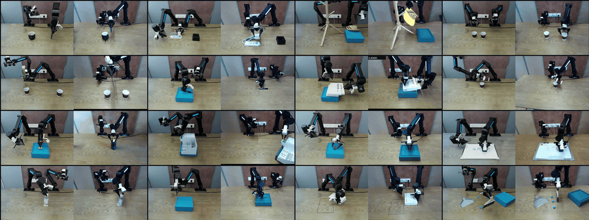

<div align="center">

# PhysLadder

**How High Can GPT-6 Astra Climb in Contact-Rich Manipulation?**

A Hierarchical, Matched Sim–Real Benchmark for Physical Interaction

[Project Page](https://physladder-benchmark.github.io/PhysLadder/) · [Quick Start](#quick-start) · [Benchmark](#benchmark) · [Documentation](#documentation) · [Citation](#citation)


[](LICENSE)

<a href="https://physladder-benchmark.github.io/PhysLadder/">
  
</a>

*Explore paired recordings, task instructions, and scene comparisons on the [interactive project page](https://physladder-benchmark.github.io/PhysLadder/).*

</div>

## Overview

PhysLadder evaluates contact-rich manipulation across **16 tasks**, **three levels** of interaction difficulty, and matched simulation and real-world setups on the **ARX R5 (方舟)** dual-arm platform.

This repository provides the simulation framework, task assets, configurations, and automatic evaluators. Each task has an independently selectable original and fixed alternative configuration, giving **32 runnable settings**. The project page brings together paired recordings, sim–real matching details, and an interactive task explorer.

## Benchmark

| Level | Interaction requirement | Tasks |
| --- | --- | --- |
| **L1** | Contact selection and geometric alignment | Marker Placement · Charger Alignment · Hat Hanging · Cup Nesting · Flower Transfer |
| **L2** | Force regulation during sustained contact | Marker Cap Removal · Book Pulling · Marble Pouring · Orange Handling · Drawer Pull & Return · Jelly Handling · Whiteboard Wiping |
| **L3** | Coordinated contact reconfiguration and force regulation | Bottle Cap Removal · Nut Removal · Stacked-Book Pushing & Rotation · Block Sweeping |

Current task IDs and historical mappings are documented in the [task numbering guide](docs/release/TASK_NUMBERING.md). Original and `variant01` settings are separate experiments; alternative settings are not uniformly position-only changes. Some L3 variants also differ in scoring or budget. See the [evaluation protocol](docs/release/PROTOCOL.md) for the exact settings.

## Quick start

### 1. Install the framework

Use Python 3.11 and an editable source checkout:

```bash
git clone https://github.com/PhysLadder-Benchmark/PhysLadder.git
cd PhysLadder
python3.11 -m venv .venv
source .venv/bin/activate
python -m pip install -e '.[test]'
```

On Windows, create the environment with `py -3.11 -m venv .venv` and activate it with `.venv\Scripts\Activate.ps1` in PowerShell.

### 2. Verify assets and inspect an experiment

These checks and execution plans run on a CPU without calling a model:

```bash
python tools/verify_runtime_assets.py --usd
python tools/release/check_task_contract.py
python tools/launch.py list
python tools/reproduce.py --tasks L2-02 L2-02_variant01
```

A full clone includes the locked runtime assets. If using a source-only release archive, first restore its matching asset bundle as described in [Installation](docs/release/INSTALL.md).

### 3. Run in simulation

Simulation requires **NVIDIA Isaac Sim 5.1**, a compatible **NVIDIA GPU**, the separate pinned **cuRobo** environment, and model access. Follow [Installation](docs/release/INSTALL.md) to configure these runtimes and the ignored `configs/runtime/local.toml` file.

```bash
python tools/reproduce.py --tasks L2-02_variant01 --execute
python tools/batch_run.py --summarize runs/PATH_TO_BATCH
```

Without `--execute`, `reproduce.py` prints a plan. It passes each configuration's existing seed, time limit, and call limit explicitly. Use `--suite original`, `--suite variant01`, or `--suite all` to select a complete suite. Offline dry runs check the execution lifecycle; they do not run physics or measure task success.

## Documentation

| Guide | Contents |
| --- | --- |
| [Installation](docs/release/INSTALL.md) | Python, Isaac Sim, cuRobo, model access, and local paths |
| [Evaluation protocol](docs/release/PROTOCOL.md) | Task configurations, prompts, budgets, scoring, and recorded outputs |
| [Task numbering](docs/release/TASK_NUMBERING.md) | Current IDs and mappings for historical records |
| [Validation](docs/release/VALIDATION.md) | Asset and software checks, with their scope and limitations |
| [Release guide](docs/release/RELEASE.md) | Source and asset packaging, project page, and provenance |
| [Optional remote deployment](skills/r5-remote-deploy/SKILL.md) | SSH deployment, fleet examples, and verification |

Runs retain configuration snapshots, model requests and replies, observations, actions, scores, and videos. Summaries distinguish task failures, timeouts, interruptions, and infrastructure errors. Real-robot operating conditions and records are documented separately from the simulation runtime.

## Development

```bash
python -m unittest discover -s tests -v
python tools/release/check_task_contract.py
python tools/verify_runtime_assets.py --check-git --usd
```

| Directory | Purpose |
| --- | --- |
| `src/robot_tasks/` | Shared execution, policies, planning, tasks, and evaluators |
| `configs/tasks/` | Original and alternative task configurations |
| `assets/runtime.lock.json` | Runtime asset inventory and SHA-256 hashes |
| `tools/release/` | Verification, packaging, and initial-state rendering |
| `site/` | Static project page and presentation media |

For bug reports, include the task ID, commit, runtime versions, and relevant logs in a [GitHub issue](https://github.com/PhysLadder-Benchmark/PhysLadder/issues). Keep credentials, machine settings, and run outputs out of commits. Changes to prompts, scoring, physics, or initial conditions should be identified explicitly so results remain comparable.

## Citation

Use [CITATION.bib](CITATION.bib) to cite the software. Paper publication metadata will be added when finalized.

```bibtex
@misc{physladder2026,
  title = {How High Can GPT-6 Astra Climb in Contact-Rich Manipulation? PhysLadder: A Hierarchical, Matched Sim--Real Benchmark for Physical Interaction},
  year = {2026},
  howpublished = {Research software},
  url = {https://github.com/PhysLadder-Benchmark/PhysLadder},
  note = {Software citation. Paper authors, venue and persistent identifier will be added when finalized.}
}
```

## License

Team-owned code is released under [Apache-2.0](LICENSE). Third-party material retains its original terms; see [NOTICE](NOTICE) and the [asset permission manifest](docs/release/asset_permissions.json).
