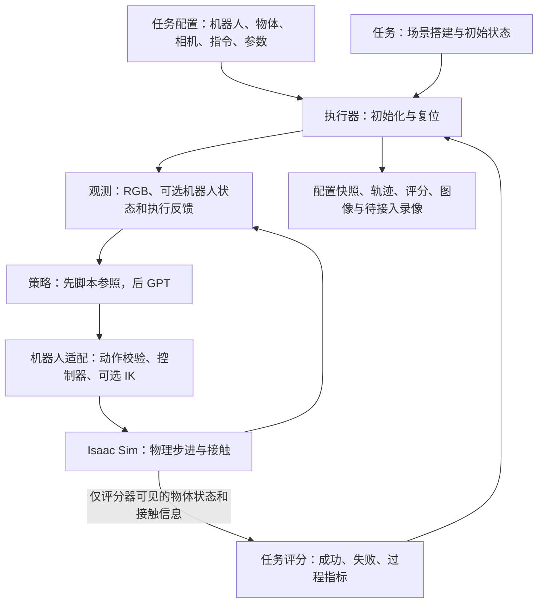

# R5 机器人任务框架

本项目使用 **ARX／方舟 R5 双臂平台**。提供厂家资产校验、URDF 导入、Isaac Sim 双臂加载、关节位置控制、仿真 TCP 与末端位姿 IK、夹爪开合、状态回读、复位、三路 RGB，以及脚本方块抓放、GPT 图像调用和 R5 动作反馈的集成校验。**正式测评任务、现场标定和力控接口仍待实现。**

当前提供两个模板：**L1-01 圆柱插孔**、**L2-02 双臂夹持力交接**。没有将此前调研的 24 项任务标记为已实现，也没有搬用旧实验 GIF 充当完整任务结果。

## 三路相机与临时参数

第三视角为轮趣 Gemini Pro（奥比 Gemini 模组），两路腕部为 Gemini 305，外壳使用供应商／官方 STEP 转换的 USD。
[相机配置](configs/cameras/r5_orbbec_provisional.toml) 集中保存分辨率、RGB 内参、畸变、安装位姿和来源。
当前内参由标称 RGB 视场角估算，畸变为零，安装位姿及 CAD 相对光心位置是用户授权的临时工程假设；
日志明确记录 `provisional_uncalibrated`。这可用于仿真开发，不代表与现场相机完成了标定对齐。

```powershell
.\tools\run_r5_check.ps1 -Check cameras -Gui
```

或在 Windows Isaac 环境运行 `python -m robot_tasks check-r5-cameras --gui`。
校验位于 `src/robot_tasks/integrationtest/camera_check.py`；结果目录中有三路各自的 MP4、GIF、PNG、
合并预览 `three_views.png`、相机跟随测量及配置快照。该校验不调用 GPT；只验证三张图能进入现有模型输入组装流程。
现有 `check-r5-gpt` 和 GPT 调试配置已启用这份三路配置，模型收到的是同一仿真时刻的三张 RGB 图像。

相机共享代码位于 `cameras/profile.py`（配置读取与校验）和 `cameras/isaac_rig.py`（挂载、渲染及读取）。
相机外壳当前仅参与视觉，不附加质量或碰撞；最终支架、现场内外参和曝光等参数仍待实测。
CAD 来源和转换方法见 [assets/cameras/README.md](assets/cameras/README.md)。

## 开发安装

Python 源码位于 `src/robot_tasks/`，配置、厂家资产、测试和工具分别保留在项目根目录下。
本项目使用源码检出的可编辑安装；首次使用或切换环境时运行一次，之后修改 `.py` 文件立即生效。

首次克隆先将 `configs/models/gpt.example.toml` 复制为 `gpt.toml`，将
`configs/runtime/windows.example.json` 复制为 `windows.json`，已有配置不覆盖。
模型服务地址和本机 D 盘路径在复制后的文件中填写，两份本机配置均由 Git 忽略。
VS Code 的 `launch.json`、`tasks.json`、`settings.json` 也只保留本地版本；
仓库提交对应的 `*.example.json`，使用前替换示例项目路径、Conda 路径和 `WINDOWS_WSL_HOST`。
下文中的本地历史结果位于忽略的 `runs/`、`reports/`，首次克隆需重新运行检查生成。

Windows Isaac Sim 环境，在 PowerShell 中执行：

```powershell
cd D:\mengjq\research_projects\llm_research\robot_task_framework
. .\tools\research_storage.ps1
$previousResearchStorage = Set-ResearchStorageEnvironment
try {
    & 'D:\conda\envs\isaac51\python.exe' -m pip install --no-deps --no-build-isolation -e .
} finally {
    Restore-ResearchStorageEnvironment $previousResearchStorage
}
```

WSL 的轻量检查环境，在 Bash 中执行：

```bash
cd /mnt/d/mengjq/research_projects/llm_research/robot_task_framework
/root/miniforge3/envs/sim-research/bin/python -m pip install --no-deps --no-build-isolation -e .
```

这两个现有环境已具备构建所需的 setuptools。本地安装不更新 Isaac Sim 或其他依赖；新建环境需先准备
`pyproject.toml` 中声明的构建依赖，或使用 `python -m pip install -e .` 自动准备构建环境。
命令仍然是 `python -m robot_tasks ...`；`src` 只用于组织源码，不是模块名的一部分。
默认配置路径和仿真子进程工作目录统一由 `src/robot_tasks/paths.py` 确定；配置中引用的相对文件路径仍以所在 TOML 的目录为基准。

目录和安装方式参考：[setuptools src 布局](https://setuptools.pypa.io/en/stable/userguide/package_discovery.html)、
[pip 可编辑安装](https://pip.pypa.io/en/stable/topics/local-project-installs/)。

## 科研环境与数据位置

Windows 的 Isaac Sim 安装在 `D:\conda\envs\isaac51`，项目在
`D:\mengjq\research_projects\llm_research`。WSL 的 Ubuntu 虚拟磁盘位于
`D:\wsl\Ubuntu\ext4.vhdx`，因此 WSL 中的 `/root/miniforge3`、`/root/.cache` 和 `/tmp`
实际也占用 D 盘，无需移到 `/mnt/d` 才算保存在 D 盘。

Windows 科研进程的运行数据统一配置在 [configs/runtime/windows.json](configs/runtime/windows.json)：

| 数据 | 实际位置 |
|---|---|
| Isaac Sim 缓存、数据和日志 | `D:\mengjq\research_projects\.runtime\windows\isaacsim\5.1` |
| 临时文件、pip 缓存、Python 字节码 | 同一运行目录的 `tmp`、`python` 子目录 |
| CUDA、Warp、OptiX 缓存 | 同一运行目录的 `nvidia` 子目录 |
| Hugging Face、Torch 模型缓存 | 同一运行目录的 `models` 子目录 |
| 仿真结果、录像和配置快照 | 本项目的 `runs/`，同样位于 D 盘 |

Python 入口、PowerShell 启动器、VS Code 的 R5 调试配置和旧 `sim_feasibility` 启动器均已接入。
`isaac51` Conda 环境也已保存这些环境变量，重新激活后生效。没有修改 Windows 全局的
`TEMP`、用户目录或 AppData。C 盘原有的 Omniverse、pip 及上述 NVIDIA 缓存目录已迁移，
原路径使用目录联接指向 D 盘；在资源管理器中看到 C 盘路径不代表数据仍占用 C 盘。

**已确认的例外：** `%LOCALAPPDATA%\NVIDIA` 下的 `GLCache` 和 `DXCache`
属于多个应用共用的图形驱动缓存，按用户确认使用 C 盘默认目录。GLCache 已恢复为普通目录，
不再通过目录联接转到 D 盘。两项单独记录为系统共享缓存例外，不计入科研数据路径检查。

检查科研路径可在项目目录执行：

```powershell
& 'D:\conda\envs\isaac51\python.exe' -m robot_tasks.runtime
```

仿真实际启动后的路径写入每次结果的 `scene.json` → `storage`，其中包括 Kit 解析出的
缓存／数据／日志位置和 Warp 实际缓存位置。`all_research_paths_on_d` 表示这些已检查路径
均落在 D 盘；`shared_system_cache_exceptions` 单独列出 GLCache 和 DXCache。每次运动检查也保存
`storage_config.json`，便于追溯当时设置。这是对科研进程已配置路径的核验，不代表追踪了整个 Windows 的所有文件写入。

实现使用 [Kit portable-root](https://docs.omniverse.nvidia.com/kit/docs/kit-manual/latest/guide/configuring.html)
与 [Conda 环境变量配置](https://docs.conda.io/projects/conda/en/stable/user-guide/tasks/manage-environments.html)。
一次性缓存迁移工具为 `tools/migrate_windows_caches.ps1`，复制后逐文件校验 SHA-256，
再建立目录联接；迁移清单保存在上述运行目录的 `migration/`。普通启动不会重复迁移。

## 运行 R5 基础运动验证

在 Windows PowerShell 中执行，复用现有 `D:\conda\envs\isaac51` 环境：

```powershell
cd D:\mengjq\research_projects\llm_research\robot_task_framework
powershell -NoProfile -ExecutionPolicy Bypass -File tools/run_r5_check.ps1

# 需要显示仿真窗口时，在上面的命令末尾加 -Gui
```

验证依次运行左右臂的六个关节、两侧夹爪、双臂同步运动和复位。蓝色支座为左臂，橙色支座为右臂。运动通过位置目标和物理驱动完成，只有初始化／复位直接设置关节状态。

结果写入独立的 `runs/R5_motion_<时间>_<后缀>/`：

| 文件 | 内容 |
|---|---|
| `motion.mp4`、`motion.gif` | 真实仿真相机帧；MP4 按仿真时间播放，GIF 为降采样预览 |
| `first_frame.png`、`latest_frame.png` | 画面预览 |
| `motion.jsonl` | 每个控制周期的目标、关节位置／速度、夹爪状态与基座位置 |
| `result.json` | 各关节响应、跟踪误差、另一侧保持误差、夹爪行程、同步动作及复位结果 |
| `process.json`、`process.log` | 仿真进程退出状态和完整运行日志 |
| `scene.json`、`scene.usda` | 场景结构记录及 USD 场景快照；快照用于结构检查，控制逻辑由 Python 提供 |
| `config.toml`、`robot_profile.toml`、`manifest.json`、`import.json` | 配置、代码哈希、资产转换依据和运行设置 |

**退出码为 0 要求运动测量通过且仿真进程正常退出。** `task_evaluated=false` 始终保留：这次验收不测插孔、交接、抓取或 GPT 的任务成功率。

本机使用 Windows／Isaac Sim 5.1／DirectX 12 渲染，关节物理使用 CPU PhysX。仿真放在独立子进程中，采用 Kit 的快速退出，避免本机完整 DLL 清理时出现的访问冲突；父进程根据退出状态和落盘测量结果共同判定是否通过。无需 ROS，无需本地部署 GPT。

## 运行 R5 末端位姿验证

在 Windows PowerShell、项目目录中执行：

```powershell
powershell -NoProfile -ExecutionPolicy Bypass -File tools/run_r5_check.ps1 -Check cartesian -Gui
# 已激活 isaac51 环境时，也可以直接运行：
python -m robot_tasks check-r5-cartesian --config configs/checks/r5_cartesian.toml --gui
```

WSL 终端通过 Windows 启动器运行同一流程：

```bash
/init /mnt/c/Windows/System32/WindowsPowerShell/v1.0/powershell.exe \
  -NoProfile -ExecutionPolicy Bypass \
  -File 'D:\mengjq\research_projects\llm_research\robot_task_framework\tools\run_r5_check.ps1' \
  -Check cartesian -Gui
```

该检查覆盖左右臂的世界／底座坐标目标、双臂同时运动、不可达目标拒绝、拒绝后恢复与复位。
输出保存在独立的 `runs/R5_cartesian_<时间>_<后缀>/`，包含 `motion.mp4`、`motion.gif`、
逐步命令与状态、误差和进程结果。视频中的青色小球标记 TCP，不参与碰撞。

实际调用顺序如下：

```text
cli.py → integrationtest/simulation_process.py → simulation_worker.py → cartesian_check.py
  → adapters.py：读取当前关节状态，接收目标位姿
  → control.py：校验整条双臂命令
  → kinematics.py：依据 URDF、TCP 和当前关节角求解 IK
  → adapters.py：下发关节位置目标
  → isaacsim.py：物理步进，读取实际 link6 位姿
  → adapters.py：换算实际 TCP，返回误差及 executing / completed
```

命令示例（在机器人已初始化、复位后）：

```python
action = Action(
    commands=(ArmCommand(
        arm="left", kind="cartesian_pose",
        values=(x, y, z, qw, qx, qy, qz), frame="world",
    ),),
    duration_s=config.control_dt_s,
)
robot.apply(action)
backend.step(action.duration_s)
state = robot.state()["left"].tcp_pose_world_wxyz
feedback = robot.feedback()
```

- `world` 是世界坐标；`robot_base` 是命令所选机械臂的底座坐标。单位为米、弧度；四元数为 `wxyz`。
- TCP 相对 `link6` 向 +X 偏移 0.140 m，坐标轴与 `link6` 一致。这是根据厂家几何设计的仿真参考点，尚未做真机标定。
- IK 是带关节限位的局部阻尼最小二乘求解，以实际关节位置为初值。平移求解容差为 0.1 mm，旋转为 0.001 rad；这是**数学求解误差**。
- 动作完成还要求**物理执行误差**小于 5 mm／0.02 rad，关节／手指误差与速度满足限制。独立检查要求连续五个采样周期完成。带重力的位置驱动仍可能存在毫米级静差，这套配置尚不足以宣称具备精密插入能力。
- `duration_s` 是本次物理推进时间，不保证一步内到达。没有新命令时继续保持此前目标；夹爪命令不覆盖机械臂位姿目标。
- 非法位姿、坐标系或 IK 失败会抛出 `ValueError`／`IKError`，同时记录 `rejected` 反馈；整条命令不下发，两侧保留旧目标。`local_solver_not_converged` 只表示局部求解失败，不能证明目标绝对不可达。
- 该接口提供末端目标到关节目标的转换；运动路径由关节驱动产生，**不保证末端沿直线走，也未实现避障、力控或抓取**。关节速度／力矩仍受仿真运行范围限制。

验收会把独立的 URDF 正运动学结果与 PhysX 回读的实际末端位姿对照，避免只验证 IK 自身的往返计算。
实际末端读取接口参考 [Isaac Sim 5.1 Prims API](https://docs.isaacsim.omniverse.nvidia.com/5.1.0/py/source/extensions/isaacsim.core.prims/docs/index.html)。

## 运行 R5 完整物理交互校验

所有仿真集成校验代码统一位于 [src/robot_tasks/integrationtest/](src/robot_tasks/integrationtest/README.md)，
包括已有的关节、末端检查和新加入的抓放检查，源码根目录不再平铺这些文件。

```powershell
powershell -NoProfile -ExecutionPolicy Bypass -File tools/run_r5_check.ps1 -Check interaction -Gui
# 已激活 isaac51 环境时：
python -m robot_tasks check-r5-interaction --config configs/checks/r5_interaction.toml --gui
```

检查依次运行左臂抓放、右臂抓放和“不闭合夹爪”的反例。机器人经 IK 和位置驱动完成接近、
下降、夹持、抬升、平移、放下、张开夹爪和退出；方块是自由动态刚体，通过实际碰撞与摩擦运动。
脚本使用配置中的已知物体位置，不具备自主视觉定位，也不调用 GPT。

验收依据实际物体状态：持续抬升、双指接触、搬运期间保持，以及完全松手后在目标区稳定停留。
张开的夹爪执行相同接近和抬升流程时，应无法提起方块；这个失败必须被正确识别。每个回合先复位，
记录物体和双臂初态误差。输出为 `runs/R5_interaction_<时间>_<后缀>/` 下的 `result.json`、
`interaction.jsonl`、`motion.mp4`、`motion.gif` 及配置／场景快照。

这是工程集成检查，不是正式任务成功率或真机能力证明。物体、摩擦、布局和夹爪参数都是仿真工程设置，
尚未做真机接触标定。接触力为仿真接触法向力，按控制周期采样，不作为峰值力或完整六维力传感器读数。

## 在 WSL 的 VS Code 中单步调试

打开仓库根目录 `llm_research`，在运行与调试列表选择 **R5: run_motion_check GUI (WSL)**，按 F5。
后台任务通过现有 PowerShell 启动器运行 Windows `isaac51`，调试器连接后自动停在
`src/robot_tasks/integrationtest/debug_motion.py` 调用检查函数前。F11 进入函数，F10 逐行执行；
也可以直接在 `integrationtest/motion_check.py` 内下断点。

此入口直接调试运动检查函数，不经过正常命令的父进程看门狗；专用 `r5_motion_debug.toml`
将墙钟上限设为 12 小时，给断点暂停留时间，物理参数与普通检查相同。记录保存在 `runs/debug/`。
末端检查选择 **R5: Cartesian check GUI (WSL)** 后按 F5，使用 `r5_cartesian_debug.toml`；
在 `integrationtest/cartesian_check.py`、`control.py`、`kinematics.py` 下断点即可。
完整交互选择 **R5: Interaction check GUI (WSL)**，在 `integrationtest/interaction_check.py` 下断点。
三种调试配置使用同一端口，一次运行一个。
停止时选择调试器的终止操作；如果只是断开连接，程序可能继续运行，可在任务终端按 Ctrl+C。

本机 Windows 环境已安装 `debugpy`。`.vscode/launch.json` 中的 `pathMappings` 把 Windows 源码路径
映射到 WSL 下同一份文件。调试端口 5678 只绑定当前 Windows 的 WSL 虚拟网卡地址；
若 WSL 重启后网关变化，用 `ip -4 route show default` 检查，并同步修改 `launch.json` 的 `connect.host`
与 `tasks.json` 的 `-DebugHost`。Windows 本地窗口仍可使用原有 **R5: check-r5 GUI (Windows)** 配置。

实现参考：[VS Code Python 远程调试](https://code.visualstudio.com/docs/python/debugging#_remote-script-debugging-with-ssh)。

## 临时仿真配置

[configs/robots/r5_sim.toml](configs/robots/r5_sim.toml) 用于关节与末端验证；[configs/checks/r5_motion.toml](configs/checks/r5_motion.toml) 和 [r5_cartesian.toml](configs/checks/r5_cartesian.toml) 设置物理步长、相机、求解迭代次数和控制增益。现场硬件配置 [r5.toml](configs/robots/r5.toml) 保持待确认状态。

- 双臂间距、初始姿态和运行范围为工程测试配置，没有声称与现场一比一匹配。
- 夹爪总开口根据厂家 STL 指端内表面及 URDF 关节原点近似换算；只验证分离状态下的开合，不声称已完成接触零点标定。
- 采用带重力的力／力矩型位置驱动。这里的驱动类型不代表已经实现面向模型的力控接口。
- 已导入每侧 9 个部件的碰撞几何，采用凸分解；当前关闭同一机械臂的自碰撞。抓放检查单独设置接触材料与偏移，验证方块接触链路，不代表厂家网格接触精度或真机动力学已标定。
- 普通关节和抓放检查保留第三视角；相机检查及 GPT 检查使用三路 RGB。真实相机内外参及现场腕部安装仍待确认。
- 仿真 TCP 已显式定义；末端检查要求 TCP 配置完整，现场版本和真机 TCP 标定仍待确认。
- TGS 使用 32 次位置迭代、0 次速度迭代，并在 `scene.json` 记录实际设置。保持原目标时不重复下发驱动命令，避免不断唤醒已经稳定的机械臂；只调整求解迭代次数不足以解决这一问题。完成阈值没有放宽，接触任务仍需单独验证求解参数。

求解设置参考 [PhysX 对 TGS 速度迭代的限制说明](https://nvidia-omniverse.github.io/PhysX/ovphysx/0.6.3/guides/limitations.html)。

实现参考：[Isaac Sim URDF 导入](https://docs.isaacsim.omniverse.nvidia.com/5.1.0/importer_exporter/ext_isaacsim_asset_importer_urdf.html)、[Articulation Controller](https://docs.isaacsim.omniverse.nvidia.com/5.1.0/robot_simulation/articulation_controller.html)。具体调用同时核对了本机安装版本的源码。

## R5 资产与配置

厂家 R5a URDF 和 9 个 STL 网格已保存在 [assets/r5](assets/r5/README.md)。来源固定到具体提交，每个文件保留 Git blob 哈希；原文件不做修改。该模型每侧包含 6 个转动关节和 2 个夹爪滑动关节。它与现场 R5 的具体版本是否一致仍需核对。

机器人属性集中在 [configs/robots/r5.toml](configs/robots/r5.toml)，任务配置只引用它并选择参与执行的机械臂：

```toml
# configs/tasks/*.toml 使用 schema_version = 2
[robot]
profile = "../robots/r5.toml"
active_arms = ["left"]  # 双臂交接改为 ["left", "right"]
```

**平台始终配置左右两只 R5；单臂任务只启用其中一侧。** 关节名在每个机械臂实例内独立使用，通过 `/World/R5/left`、`/World/R5/right` 区分；未收到新动作的机械臂继续保持已有目标。旧 schema 1 任务配置会明确拒绝，不自动猜测迁移。

下表是现场硬件配置 `r5.toml` 的状态；本轮仿真使用上文独立列出的 `r5_sim.toml`。

| 配置内容 | 当前情况 | 后续需要补充 |
|---|---|---|
| 模型、网格与关节映射 | 已导入 Isaac Sim，关节运动可检查 | 后续验证物体接触和碰撞精度 |
| 左右臂安装位置与初始关节角 | 未填写 | 现场测量，或注明来源的仿真布局 |
| 工具中心 TCP | 未填写；`link6` 仅是夹爪父链接 | 定义实际抓取中心相对 `link6` 的位姿 |
| 夹爪开口换算 | 未填写 | 标定两指总开口与两个滑动关节的关系 |
| 运行限位、力／力矩及速度上限 | 未填写 | 厂家资料或明确设定的仿真运行范围及来源 |
| 现场硬件版本匹配 | 待确认 | 核对机械臂和末端夹爪版本 |

现场配置中的缺项保留为 `None`／空值。临时仿真配置独立记录工程参数及依据。厂家文件含 ±10 rad、速度 1000 等宽泛数值，因此资产参数与实际运行限制分别保存。离线校验不证明动力学准确、碰撞模型可用或完整任务可执行。

## 整体流程



策略根据观测给动作；控制器将动作转换为机器人可执行的目标；仿真计算动作后的物理结果；评分器独立判断任务是否完成。**IK（逆运动学）已实现末端目标位置和姿态到关节目标的转换，目前验证范围是空载运动。**

## 目录与职责

```text
robot_task_framework/
├── assets/r5/              厂家原始 URDF、STL、来源锁定清单
├── configs/robots/         R5 共享配置、标定与运行限制
├── configs/tasks/          每项任务的指令、参与臂、相机和参数
├── configs/checks/         R5 基础运动验证配置
├── configs/runtime/        Windows 科研临时文件、缓存和日志位置
├── src/robot_tasks/        Python 包源码，可编辑安装后通过 robot_tasks 导入
│   ├── paths.py            源码检出的项目根目录与资源定位
│   ├── runtime.py          科研运行目录配置及实际存储路径审计
│   ├── cli.py              list / validate-robot / inspect / dry-run / check-r5 / run
│   ├── integrationtest/    关节、末端、抓放校验；场景、评分、录像、子进程与调试入口
│   ├── config.py           配置读取与基础校验
│   ├── types.py            观测、动作、反馈、评分的数据结构
│   ├── interfaces.py       模块之间的接口约定
│   ├── registry.py         任务名称、编号、证据和实现状态
│   ├── runner.py           一次完整试验的执行循环
│   ├── recording.py        配置快照、逐步日志和 RGB 帧保存
│   ├── backends/           Isaac Sim 后端、渲染配置、占位后端
│   ├── robots/profile.py   类型化机器人配置读取
│   ├── robots/urdf.py      不依赖仿真器的 URDF 结构检查
│   ├── robots/audit.py     文件完整性、映射和运行参数校验
│   ├── robots/importer.py  URDF → 独立 USD 资产及缓存校验
│   ├── robots/control.py   动作校验和夹爪开口换算
│   ├── robots/transforms.py 坐标变换与位姿误差计算
│   ├── robots/kinematics.py URDF 正运动学、雅可比和有界局部 IK
│   ├── robots/adapters.py  R5 关节／末端驱动、实际 TCP、反馈与复位
│   ├── policies/           GPT 配置、Responses 请求、RGB 历史与动作解析
│   ├── integrationtest/    API、R5 运动、接触、GPT 闭环及调试校验
│   └── tasks/              场景、复位、成功与失败判定
├── tests/                  资产、配置、执行生命周期与证据检查
├── tools/                  固定版本资产下载、Windows 启动与框架检查
├── reports/                离线校验报告
├── environment.yml         可选轻量 Conda 环境定义
├── pyproject.toml          src 包发现、构建和命令行入口
└── runs/                   运行后自动生成的记录
```

| 模块 | 当前状态 | 后续填什么 |
|---|---|---|
| 配置、注册、执行循环、日志 | 已实现 | 随具体任务补充参数校验 |
| 流程自检 | 可运行 | 只验证模块连接，不算物理或任务验证 |
| Isaac Sim 后端 | 已实现基础链路与临时三路 RGB | 现场相机标定、任务专属物体与接触状态 |
| R5 资产与共享配置 | 已实现 | 核对现场版本，补充标定和运行参数 |
| R5 仿真适配 | 已实现关节、夹爪与末端目标控制／IK，提供脚本抓放集成检查 | 正式任务策略、路径规划与力控 |
| 圆柱插孔 | 待实现 | 抓取、对准、插入、释放、稳定性评分 |
| 双臂夹持力交接 | 待实现 | 两侧接触、载荷转移、释放与掉落判断 |
| GPT 策略 | 已接 Responses、RGB 抽帧、有限历史、动作校验与调用记录 | 接入正式任务并确定测评协议 |
| 正式任务脚本参照 | 待实现；脚本方块抓放集成检查可运行 | 各测评任务独立的脚本参照 |
| GIF / MP4 | 运动检查已实现 | 后续接入完整任务的录像流程 |

## 先运行框架

要求 Python 3.11 或以上，先完成上面的可编辑安装。配置与资产检查使用标准库，运动学计算和相应单元测试依赖 NumPy；真实仿真额外使用现有 Isaac Sim 环境及其中的 Pillow、OpenCV。无需重新安装 Isaac Sim。`environment.yml` 仅用于轻量离线环境，不包含仿真依赖。

在 Windows PowerShell 中：

```powershell
cd D:\mengjq\research_projects\llm_research\robot_task_framework
$taskPython = 'D:\conda\envs\isaac51\python.exe'

# 列出模板及状态
& $taskPython -m robot_tasks list

# 校验厂家资产和关节映射，同时列出待确认参数
& $taskPython -m robot_tasks validate-robot --profile configs/robots/r5.toml --output reports/r5_asset_audit.json

# 严格检查：运行参数未填写时返回退出码 2
& $taskPython -m robot_tasks validate-robot --profile configs/robots/r5.toml --require-ready

# 检查任务引用的机器人配置，不启动仿真
& $taskPython -m robot_tasks inspect --config configs/tasks/l1_01_cylinder_insertion.toml

# 插孔模板的占位流程自检
& $taskPython -m robot_tasks dry-run --config configs/tasks/l1_01_cylinder_insertion.toml

# 双臂交接模板的占位流程自检
& $taskPython -m robot_tasks dry-run --config configs/tasks/l2_02_dual_arm_handover.toml
```

WSL 中进入同一目录，使用 `/root/miniforge3/envs/sim-research/bin/python -m robot_tasks ...` 即可。

`validate-robot` 默认只要求资产和映射有效，报告中 `execution_configuration_ready=false` 会明确保留缺项；加 `--require-ready` 才要求运行参数齐全。两种模式都不启动仿真、不连接真机或调用模型，`simulation_validated` 始终为 `false`。配置内的文件路径相对各自 TOML 所在目录解析。

`dry-run` 默认走 3 步，只产生占位动作和 2×2 黑色 RGB 帧，输出 `dry_run_complete`、`task_evaluated=false`、`success=null`。**它不会打开仿真窗口，也没有可展示任务效果的 GIF。**

真实仿真的统一入口已保留：

```powershell
& $taskPython -m robot_tasks run --config configs/tasks/l1_01_cylinder_insertion.toml --policy scripted
```

当前 `run` 会先检查完整任务配置；存在未确认项时以退出码 `2` 报告缺项。具体任务场景、任务策略及评分仍未实现；三路 RGB 已在独立集成检查中接通。基础机器人验证请使用独立的 `check-r5` 入口。`--policy gpt --model-config configs/models/gpt.toml` 已接模型策略，但不会替代尚未实现的任务场景；模型链路验证使用 `check-gpt-api` 和 `check-r5-gpt`。

## GPT 接口与 R5 闭环

模型配置使用本机 `configs/models/gpt.toml`，从 [gpt.example.toml](configs/models/gpt.example.toml) 复制，
填写实际服务地址和模型 ID。客户端追加 `/responses`，使用 Bearer 认证、流式响应、`store=false`；
不自动追加 `/v1`，不自动切换模型。服务商要求 `/v1` 时，由配置中的根地址显式包含它。
Token 只读取 `OPENAI_API_KEY`：优先当前进程环境，Windows 下缺失时读取用户环境，兼容刚执行 `setx` 而尚未重启的编辑器。
不读取 Codex 的 `auth.json`，不需要在本地部署模型。WSL 原生 Python 需要自己的环境变量；现有启动器运行 Windows Python。

在框架目录的 Windows PowerShell 中运行：

```powershell
# 只发起一次图像和动作格式检查；不启动 Isaac Sim。
powershell -NoProfile -ExecutionPolicy Bypass -File tools/run_r5_check.ps1 -Check api

# GPT 观察真实渲染图，控制仿真 R5，收到执行反馈后决定下一动作。
powershell -NoProfile -ExecutionPolicy Bypass -File tools/run_r5_check.ps1 -Check gpt -Gui
```

已激活环境也可用 `python -m robot_tasks check-gpt-api` 或
`python -m robot_tasks check-r5-gpt --gui`。VS Code 的 WSL 窗口选择
**R5: GPT check GUI (WSL)**，F5 后自动停在调试入口，F11 进入闭环；可在
`GPTPolicy.act()`、`ResponsesClient.generate()` 和 `R5Adapter.apply()` 设置断点。

| 文件 | 作用 |
|---|---|
| `policies/model_config.py` | 校验服务地址、模型 ID、请求预算与环境变量名；凭据不进入配置 |
| `policies/responses.py` | HTTPS／SSE 请求、完整响应确认、模型 ID 校验、错误脱敏 |
| `policies/gpt.py` | RGB 编码、有限观测历史、模型 prompt、策略调用 |
| `policies/action_codec.py` | JSON 转 `Action`；检查命令种类、臂名、单位、四元数、关节和夹爪范围 |
| `integrationtest/gpt_api_check.py` | 明确标注的人工色块图片，验证图片输入和结构化动作返回 |
| `integrationtest/gpt_check.py` | 真实渲染 RGB → GPT → R5 物理运动 → 新观测与反馈 |

动作链路保留 R5 的底层 IK 与位置驱动。模型生成绝对末端位姿、六关节位置或夹爪总开口；不执行模型生成的 Python。
本次集成任务固定为：左臂 TCP 向上移动 20 mm、打开夹爪至 60 mm、观察结果并停止，右臂保持不动。
独立检查实际位姿和夹爪变化；模型说“完成”不能让检查自动通过。**这不是自主抓取或强接触任务成功率。**

每轮执行模型目标，最多等待 `max_action_steps` 个控制周期，再把实际反馈提供给模型。
等待 API 时物理时间暂停；录像按仿真时间播放，实际耗时另存。默认最多 6 次调用、保留 2 轮历史，
请求超时 90 秒。没有自动重试、自动修复动作或脚本替模型补动作。格式错误、非单位四元数、越界、IK 不可达、拒答、
未完整结束的响应和接口错误均停止本轮并留记录。`structured_output=true` 会发送 JSON Schema，
本地仍独立校验；中转服务不一定完整保留上游参数，不能仅凭 HTTP 200 判断格式约束生效。
控制约定同时通过 developer 消息发送，动作数字使用六位小数，避免复制科学计数法时丢失指数。

`runs/R5_gpt_*/` 保存 `model.jsonl`（请求次数、响应文本、耗时、token 用量、校验状态）、
`episode.jsonl`（实际状态、动作和反馈）、`observation_*.png`（模型收到的缩放后图片）、
`motion.mp4`／`motion.gif`、配置快照、系统 prompt、资产审计和 `result.json`。
API-only 输出位于 `runs/GPT_api_*/`，图片是测试色块，不是真实机器人图像。
所有记录均在 D 盘；不保存 Authorization 或 Token。错误响应正文不写日志。

接口参考：[Responses API](https://developers.openai.com/api/docs/guides/text)、
[图片输入](https://developers.openai.com/api/docs/guides/images-vision)、
[结构化输出](https://developers.openai.com/api/docs/guides/structured-outputs)。

## 一次试验的约定

- **执行顺序：**打开后端 → 搭场景 → 初始化机器人 → 复位 → 读取观测 → 策略动作 → 机器人执行 → 物理步进 → 新观测与评分，循环直到终止。
- **动作：**关节位置、末端位姿或夹爪总开口；双臂命令放在同一 `Action` 中，在同一次物理步进前应用。具体 SDK 转换、关节限制和 IK 留给机器人适配层。尚未定义力控接口。
- **单位：**距离用米，角度用弧度，时间用秒；位姿四元数顺序固定为 `w,x,y,z`。夹爪开口指两指总距离。
- **模型可见信息：**相机 RGB；可配置是否提供机器人状态和执行反馈。GPT 接收当前采样的 RGB PNG 图片和最多两轮历史观测／动作；这是视频抽帧，不是原生视频流。模型配置可修改历史长度与图片尺寸。
- **评分信息：**物体真值位姿、接触力等走 `EvaluationState`，不传进策略输入。若将力觉提供给 GPT，需显式扩展观测协议。
- **停止：**策略声称完成不等于成功。成功必须来自任务评分器；时间耗尽、异常或尚未评分时，不生成成功率。
- **时间预算：**区分物理时间和墙钟时间。模型请求有 socket 超时和返回后的总耗时检查，超时结果不执行；仿真 CLI 子进程另有总墙钟 watchdog。等待 API 期间仿真不推进，因此不能据此评价真实动态响应。
- **复现：**保存任务与机器人配置、资产来源清单、随机种子、代码哈希和逐步动作。配置快照保留原始内容，重放需使用相同仓库布局及锁定资产。传递 seed 不等于保证 GPU 物理完全确定，后续需记录仿真版本并复核重复性。

输出目录如下；每次运行使用独立目录，不覆盖已有结果：

```text
runs/<任务编号>_<模式>_<时间>_<随机后缀>/
├── config.toml             本次配置副本
├── robot_profile.toml      R5 共享配置副本
├── asset_source.lock.json  厂家资产来源与文件哈希副本
├── manifest.json           模式、种子、参与臂、配置哈希、代码哈希和资产路径
├── episode.jsonl           每步动作、观测引用、反馈、评分和调用耗时
├── result.json             终止原因、是否真实评分、成功状态和错误
└── frames/<相机名>/*.ppm    RGB 帧；当前自检仅为黑色占位帧
```

## 每个任务需要补齐什么

| 任务 | 场景和动作过程 | 成功判定需要明确 | 当前可参考内容 |
|---|---|---|---|
| L1-01 圆柱插孔 | 工作台、可抓取圆柱、孔座；机械臂抓起后对准、插入并释放 | 插入深度、轴向偏差、释放后的稳定时间、掉落或卡住 | [此前插孔基础实验](../sim_feasibility/results/experiments/insertion-20260925-215330/summary.json)，它采用重力落入 |
| L2-02 双臂夹持力交接 | 两臂共同可达区域、物体、真实摩擦夹持；接收侧承重后供给侧释放 | 载荷转移、滑移、掉落、接收侧独立稳定持物 | [StationeryBench 尺子交接任务](../sim_feasibility/third_party/stationerybench/docs/tasks/ruler_handover.md)，它是真机流程参考 |

后端复用了此前确认可用的 D3D12 设置；机器人模型与控制映射全部使用本框架的 R5 配置。生成资产在 `build/r5/<输入哈希>/`，厂家原始文件保持不变。

R5 脚本方块抓放与 GPT 动作闭环已提供独立集成入口。下一步把物体场景、复位和评分落实到首个正式任务，再让脚本与 GPT 使用同一套任务接口运行；相机现场标定和力控仍待补齐。新增任务时，在 `src/robot_tasks/tasks/` 增加场景、复位、评分实现，在 `configs/tasks/` 增加配置，并更新 `registry.py` 的状态与证据。

## 框架检查

```powershell
& $taskPython -m unittest discover -s tests -v
# 或同时检查两个任务配置与自检入口：
powershell -NoProfile -ExecutionPolicy Bypass -File tools/check_framework.ps1
```

检查覆盖资产缺失与损坏、错误关节映射、单／双臂选择、运行参数缺项、夹爪换算与限位冲突，以及占位结果、模型信息边界和异常关闭等。它们验证软件约定，不验证任何物理任务。
